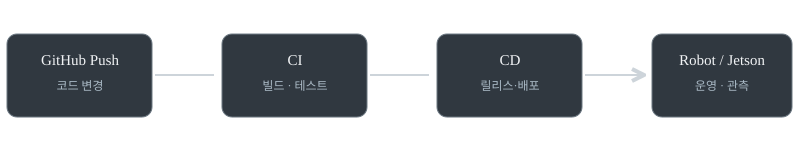

> [!PROMPT]
> dev, ops가 뭔지. ci,cd가 어떤건지. 그리고 완성된 코드의 readme작성 및 불필요파일 정리를 통한 github 공개는 어떤 작업에 해당하는지, 어떤 경험과 역량으로 표현할 수 있을 지 설명해줘

> [!NOTE]
> 아래는 제공된 ChatGPT 답변 전문입니다. 표의 레이아웃만 정리했고, 원문에서 문단으로 풀어진 카드 배치(1·2·4절)는 게시 시 카드로 복원했습니다. 문장은 바꾸지 않았습니다.

# Dev, Ops, CI/CD 개념과 GitHub 프로젝트 공개 역량

먼저 핵심부터 정리하면, 완성된 코드를 정리하고 README를 작성하여 GitHub에 공개하는 작업은 단순한 코드 업로드가 아니라, 소프트웨어 문서화(Documentation), 저장소 관리(Repository Management), 프로젝트 배포 준비(Release Preparation)에 해당합니다.

다만 이 작업만으로 DevOps나 CI/CD를 수행했다고 표현하기는 어렵습니다.

로보틱스 소프트웨어 개발 관점에서 각 개념의 차이와, 취업 시 어떤 역량으로 표현할 수 있는지 구분해 보겠습니다.

## 1. Dev, Ops, DevOps란?

<div class="visual-grid">
<div class="visual-card"><div class="visual-card__title">Dev</div><div class="visual-card__sub">Development</div><div class="visual-card__body"><p>개발(Development)</p><p>소프트웨어의 기능을 설계하고 구현하며 테스트하는 영역입니다. 예를 들어 ROS 2 노드 개발, YOLO 추론 파이프라인 구현, 로봇 제어 알고리즘 작성 등이 해당합니다.</p></div></div>
<div class="visual-card"><div class="visual-card__title">Ops</div><div class="visual-card__sub">Operations</div><div class="visual-card__body"><p>운영(Operations)</p><p>개발된 소프트웨어가 실제 환경에서 안정적으로 실행되도록 배포, 설정, 모니터링, 장애 대응, 유지보수 등을 수행하는 영역입니다. 예를 들어 로봇의 ROS 2 프로세스 운영, 로그 수집, 장애 발생 시 서비스 복구 등이 있습니다.</p></div></div>
<div class="visual-card"><div class="visual-card__title">DevOps</div><div class="visual-card__sub">Dev + Ops</div><div class="visual-card__body"><p>개발과 운영을 연결하는 문화·실천 방법</p><p>개발부터 테스트, 배포, 운영까지의 과정을 협업과 자동화로 연결해 신속하고 안정적으로 소프트웨어를 제공하는 접근 방식입니다. CI/CD, Docker, 자동 테스트, 모니터링 등이 관련 기술 또는 활동입니다.</p></div></div>
</div>

DevOps는 별도의 개발 단계 하나를 뜻하는 것이 아닙니다. 개발과 운영 사이의 간극을 줄이는 전체적인 접근 방식이라고 이해하면 됩니다.

## 2. CI/CD란?

CI/CD는 소프트웨어 변경 사항을 검증하고 배포하는 과정을 자동화하는 데 사용하는 대표적인 DevOps 실천 방법입니다.

- CI (Continuous Integration, 지속적 통합): 코드 변경을 공유 브랜치에 통합하면서 빌드·테스트·정적 분석 등을 자동 수행해 오류를 조기에 발견합니다.
- CD (Continuous Delivery, 지속적 제공): 검증된 코드를 언제든 배포 가능한 상태로 자동 준비합니다. 실제 운영 배포에는 승인이 필요할 수 있습니다.
- CD (Continuous Deployment, 지속적 배포): 검증 단계를 통과한 변경 사항을 별도의 수동 승인 없이 운영 환경까지 자동 배포합니다.

CI/CD 파이프라인 예시

<div class="visual-grid flow">
<div class="visual-card"><div class="visual-card__title">개발자가 GitHub에 Push</div><div class="visual-card__body"><p>코드 변경 발생</p></div></div>
<div class="visual-card"><div class="visual-card__title">CI — 자동 검증</div><div class="visual-card__sub">Integration</div><div class="visual-card__body"><p>빌드</p><p>테스트</p><p>코드 검사</p></div></div>
<div class="visual-card"><div class="visual-card__title">CD — 릴리스/배포</div><div class="visual-card__sub">Delivery / Deployment</div><div class="visual-card__body"><p>배포물 생성</p><p>패키지·이미지</p><p>환경에 배포</p><p>승인 또는 자동</p></div></div>
<div class="visual-card"><div class="visual-card__title">PC / Jetson / 로봇 시스템에서 실행</div><div class="visual-card__body"><p>실제 운영과 모니터링</p></div></div>
</div>

가령 ROS 2 패키지에 GitHub Actions를 적용한다면, 개발자가 Push할 때마다 Ubuntu 환경에서 의존성을 설치하고 `colcon build`와 `colcon test`를 자동 실행하도록 설정할 수 있습니다. 여기까지는 CI입니다.

검증된 Docker 이미지를 레지스트리에 게시하고, 로봇의 엣지 PC나 Jetson에 배포하는 절차를 추가하면 CD 영역으로 확장할 수 있습니다.

단, GitHub에 Push하는 행위 자체가 CI/CD는 아닙니다. 자동화된 검증·전달·배포 절차가 있는지가 중요합니다.

## 3. README 작성, 불필요 파일 정리, GitHub 공개는 어떤 작업인가?

이 세 가지는 서로 연관되지만 목적과 기술적 의미가 다릅니다.

| 실제 수행한 작업 | 해당 분야·활동 | 보여줄 수 있는 역량 |
|---|---|---|
| README 작성 | Technical Documentation | 기술 문서화, 지식 전달 |
| 코드 구조·디렉터리 정리 | Codebase Organization | 코드 구조 설계, 유지보수성 |
| 불필요한 파일 삭제 | Repository Hygiene | 저장소 품질 관리 |
| `.gitignore` 구성 | Version Control Management | Git·버전 관리 |
| 의존성 및 실행 명령 정리 | Reproducibility | 개발 환경 재현성 |
| GitHub 공개 | Open-source Publication / Project Sharing | 프로젝트 공유·공개 준비 |
| 태그, 버전, Release 작성 | Release Management | 버전·릴리스 관리 |

특히 코드가 정상 동작하는 것과 다른 개발자가 그 코드를 재사용할 수 있도록 정리하는 것은 별개의 역량입니다.

예를 들어 자신이 만든 ROS 2 패키지를 다른 사람이 GitHub에서 Clone한 뒤, README에 따라 의존성을 설치하고 실행할 수 있다면 이는 단순한 소스 코드 정리보다 한 단계 높은 수준의 결과물입니다.

이 경우에는 다음 세 가지를 구분하는 것이 유용합니다.

- Maintainability(유지보수성): 코드 구조와 설정이 명확하여 수정하고 관리하기 쉬운가?
- Reproducibility(재현성): 다른 개발 환경에서도 동일한 실행 결과를 재현할 수 있는가?
- Usability(사용성): 외부 사용자가 프로젝트 목적과 사용 방법을 쉽게 이해할 수 있는가?

세 가지가 모두 잘 갖춰졌다면 소프트웨어 엔지니어링 역량을 보여주는 좋은 포트폴리오가 됩니다.

## 4. 자기소개서·포트폴리오에서 어떻게 표현할까?

수행 수준에 따라 표현을 달리하는 것이 좋습니다.

<div class="visual-grid">
<div class="visual-card"><div class="visual-card__title">기본</div><div class="visual-card__sub">README 작성 + 파일 정리 + GitHub 공개</div><div class="visual-card__body"><p>기술 문서화 및 Git 기반 프로젝트 관리 역량</p><p>개발한 소프트웨어의 소스 코드와 디렉터리 구조를 정리하고, README를 통해 프로젝트 아키텍처 및 실행 절차를 문서화하여 GitHub에 공개했습니다.</p></div></div>
<div class="visual-card"><div class="visual-card__title">중급</div><div class="visual-card__sub">의존성 관리 + 환경 재현 및 실행 검증</div><div class="visual-card__body"><p>소프트웨어 유지보수성 및 재현성 확보 역량</p><p>ROS 2 패키지의 의존성과 실행 환경을 명세하고 불필요한 개발 산출물을 제거했습니다. 이후 신규 환경에서 빌드 및 실행 절차를 검증해 프로젝트의 재현성과 유지보수성을 개선했습니다.</p></div></div>
<div class="visual-card"><div class="visual-card__title">심화</div><div class="visual-card__sub">GitHub Actions + 테스트 자동화 + 릴리스</div><div class="visual-card__body"><p>CI/CD 파이프라인 구축 및 소프트웨어 품질 관리 역량</p><p>GitHub Actions 기반 CI 파이프라인을 구성하여 코드 변경 시 ROS 2 패키지의 빌드 및 테스트를 자동화했습니다. 이를 통해 코드 통합 과정에서 발생하는 오류를 조기에 감지하고 소프트웨어 변경 사항의 검증 절차를 표준화했습니다.</p></div></div>
</div>

위 문장은 해당 작업을 실제로 수행했을 때 사용할 수 있는 표현입니다.

## 5. 로보틱스 엔지니어 관점에서 발전시키는 방법

ROS 2, Python, AI 모델을 다루는 프로젝트라면 다음 순서로 역량을 확장하는 것을 추천합니다.

| 단계 | 추가 수행 작업 | 기술 역량 |
|---|---|---|
| 1 | README, 구조 정리, `.gitignore` | Git, Documentation |
| 2 | `requirements.txt`, `package.xml`, 환경 설정 문서화 | Dependency Management |
| 3 | 다른 PC에서 Clone 후 빌드·실행 검증 | Reproducibility |
| 4 | `pytest`, `colcon test` 도입 | Software Testing |
| 5 | GitHub Actions로 빌드·테스트 자동화 | CI |
| 6 | Docker 이미지 및 버전별 Release 자동 생성 | CI/CD, Release Engineering |
| 7 | Jetson·로봇 배포 및 모니터링·롤백 체계 구축 | Deployment, Operations |

로보틱스에서는 특히 3~5단계의 가치가 큽니다. ROS 2는 운영체제, 배포판, 패키지 의존성, 센서 드라이버 등 환경에 영향을 받기 때문입니다.

다만 시뮬레이션이나 단위 테스트를 통과했다고 실제 로봇의 안전성이 보장되는 것은 아닙니다. 실기기 배포에는 별도의 통합 시험, 안전 검증, 롤백 절차가 필요합니다.

## 6. 최종적으로 어떤 역량을 강조하는 것이 좋은가?

현재 질문에서 설명한 작업만을 기준으로 한다면, 가장 적절한 표현은 Git 기반 소프트웨어 형상 관리 및 기술 문서화 역량입니다.

단순한 파일 정리보다 구조 개선과 실행 환경 표준화까지 수행했다면 소프트웨어 유지보수성 및 재현성 개선 경험으로 확장할 수 있습니다.

이력서의 기술 키워드로는 `Git/GitHub`, `Technical Documentation`, `Repository Management`, `Software Maintenance`가 적절합니다. CI/CD는 자동화된 빌드·테스트·배포 경험을 확보한 이후 기재하는 것이 정확합니다.

참고 문서: [GitHub Actions 공식 문서](https://docs.github.com/en/actions/get-started/understand-github-actions?utm_source=chatgpt.com) · [Red Hat CI/CD 개념 설명](https://www.redhat.com/en/topics/devops/what-is-ci-cd?utm_source=chatgpt.com)

확신도: 검증됨(같은 턴 도구 출력으로 확인) — DevOps·CI/CD 개념 및 자동화 구분. 사용자 작업에 대한 역량 평가는 추론.

내가 채워넣은 가정: README 작성, 불필요 파일 정리 및 GitHub 공개를 수행했거나 수행할 예정이며, 별도의 CI/CD 자동화는 아직 구축하지 않은 것으로 가정.

확인 요청: 없음.

## CI/CD 파이프라인 시각화

> [!WARNING]
> 추가 시각화 · 이번 게시용 재생성. 원문 텍스트에 설명된 파이프라인을 기반으로 새로 제작한 개념도입니다. 과거 답변 화면을 그대로 복제한 것은 아닙니다.



<details>
<summary>원문 텍스트 그대로 확인 (서식 복원 전)</summary>

````text
# Dev, Ops, CI/CD 개념과 GitHub 프로젝트 공개 역량

먼저 핵심부터 정리하면, 완성된 코드를 정리하고 README를 작성하여 GitHub에 공개하는 작업은 단순한 코드 업로드가 아니라, 소프트웨어 문서화(Documentation), 저장소 관리(Repository Management), 프로젝트 배포 준비(Release Preparation)에 해당합니다.

다만 이 작업만으로 DevOps나 CI/CD를 수행했다고 표현하기는 어렵습니다.

로보틱스 소프트웨어 개발 관점에서 각 개념의 차이와, 취업 시 어떤 역량으로 표현할 수 있는지 구분해 보겠습니다.

## 1. Dev, Ops, DevOps란?

Dev

Development

개발(Development)

소프트웨어의 기능을 설계하고 구현하며 테스트하는 영역입니다. 예를 들어 ROS 2 노드 개발, YOLO 추론 파이프라인 구현, 로봇 제어 알고리즘 작성 등이 해당합니다.

Ops

Operations

운영(Operations)

개발된 소프트웨어가 실제 환경에서 안정적으로 실행되도록 배포, 설정, 모니터링, 장애 대응, 유지보수 등을 수행하는 영역입니다. 예를 들어 로봇의 ROS 2 프로세스 운영, 로그 수집, 장애 발생 시 서비스 복구 등이 있습니다.

DevOps

Dev + Ops

개발과 운영을 연결하는 문화·실천 방법

개발부터 테스트, 배포, 운영까지의 과정을 협업과 자동화로 연결해 신속하고 안정적으로 소프트웨어를 제공하는 접근 방식입니다. CI/CD, Docker, 자동 테스트, 모니터링 등이 관련 기술 또는 활동입니다.

DevOps는 별도의 개발 단계 하나를 뜻하는 것이 아닙니다. 개발과 운영 사이의 간극을 줄이는 전체적인 접근 방식이라고 이해하면 됩니다.

## 2. CI/CD란?

CI/CD는 소프트웨어 변경 사항을 검증하고 배포하는 과정을 자동화하는 데 사용하는 대표적인 DevOps 실천 방법입니다.

- CI (Continuous Integration, 지속적 통합): 코드 변경을 공유 브랜치에 통합하면서 빌드·테스트·정적 분석 등을 자동 수행해 오류를 조기에 발견합니다.
- CD (Continuous Delivery, 지속적 제공): 검증된 코드를 언제든 배포 가능한 상태로 자동 준비합니다. 실제 운영 배포에는 승인이 필요할 수 있습니다.
- CD (Continuous Deployment, 지속적 배포): 검증 단계를 통과한 변경 사항을 별도의 수동 승인 없이 운영 환경까지 자동 배포합니다.

CI/CD 파이프라인 예시

개발자가 GitHub에 Push

코드 변경 발생

CI — 자동 검증

Integration

빌드

테스트

코드 검사

CD — 릴리스/배포

Delivery / Deployment

배포물 생성

패키지·이미지

환경에 배포

승인 또는 자동

PC / Jetson / 로봇 시스템에서 실행

실제 운영과 모니터링

가령 ROS 2 패키지에 GitHub Actions를 적용한다면, 개발자가 Push할 때마다 Ubuntu 환경에서 의존성을 설치하고 `colcon build`와 `colcon test`를 자동 실행하도록 설정할 수 있습니다. 여기까지는 CI입니다.

검증된 Docker 이미지를 레지스트리에 게시하고, 로봇의 엣지 PC나 Jetson에 배포하는 절차를 추가하면 CD 영역으로 확장할 수 있습니다.

단, GitHub에 Push하는 행위 자체가 CI/CD는 아닙니다. 자동화된 검증·전달·배포 절차가 있는지가 중요합니다.

## 3. README 작성, 불필요 파일 정리, GitHub 공개는 어떤 작업인가?

이 세 가지는 서로 연관되지만 목적과 기술적 의미가 다릅니다.

| 실제 수행한 작업 | 해당 분야·활동 | 보여줄 수 있는 역량 |
|---|---|---|
| README 작성 | Technical Documentation | 기술 문서화, 지식 전달 |
| 코드 구조·디렉터리 정리 | Codebase Organization | 코드 구조 설계, 유지보수성 |
| 불필요한 파일 삭제 | Repository Hygiene | 저장소 품질 관리 |
| `.gitignore` 구성 | Version Control Management | Git·버전 관리 |
| 의존성 및 실행 명령 정리 | Reproducibility | 개발 환경 재현성 |
| GitHub 공개 | Open-source Publication / Project Sharing | 프로젝트 공유·공개 준비 |
| 태그, 버전, Release 작성 | Release Management | 버전·릴리스 관리 |

특히 코드가 정상 동작하는 것과 다른 개발자가 그 코드를 재사용할 수 있도록 정리하는 것은 별개의 역량입니다.

예를 들어 자신이 만든 ROS 2 패키지를 다른 사람이 GitHub에서 Clone한 뒤, README에 따라 의존성을 설치하고 실행할 수 있다면 이는 단순한 소스 코드 정리보다 한 단계 높은 수준의 결과물입니다.

이 경우에는 다음 세 가지를 구분하는 것이 유용합니다.

- Maintainability(유지보수성): 코드 구조와 설정이 명확하여 수정하고 관리하기 쉬운가?
- Reproducibility(재현성): 다른 개발 환경에서도 동일한 실행 결과를 재현할 수 있는가?
- Usability(사용성): 외부 사용자가 프로젝트 목적과 사용 방법을 쉽게 이해할 수 있는가?

세 가지가 모두 잘 갖춰졌다면 소프트웨어 엔지니어링 역량을 보여주는 좋은 포트폴리오가 됩니다.

## 4. 자기소개서·포트폴리오에서 어떻게 표현할까?

수행 수준에 따라 표현을 달리하는 것이 좋습니다.

기본

README 작성 + 파일 정리 + GitHub 공개

기술 문서화 및 Git 기반 프로젝트 관리 역량

개발한 소프트웨어의 소스 코드와 디렉터리 구조를 정리하고, README를 통해 프로젝트 아키텍처 및 실행 절차를 문서화하여 GitHub에 공개했습니다.

중급

의존성 관리 + 환경 재현 및 실행 검증

소프트웨어 유지보수성 및 재현성 확보 역량

ROS 2 패키지의 의존성과 실행 환경을 명세하고 불필요한 개발 산출물을 제거했습니다. 이후 신규 환경에서 빌드 및 실행 절차를 검증해 프로젝트의 재현성과 유지보수성을 개선했습니다.

심화

GitHub Actions + 테스트 자동화 + 릴리스

CI/CD 파이프라인 구축 및 소프트웨어 품질 관리 역량

GitHub Actions 기반 CI 파이프라인을 구성하여 코드 변경 시 ROS 2 패키지의 빌드 및 테스트를 자동화했습니다. 이를 통해 코드 통합 과정에서 발생하는 오류를 조기에 감지하고 소프트웨어 변경 사항의 검증 절차를 표준화했습니다.

위 문장은 해당 작업을 실제로 수행했을 때 사용할 수 있는 표현입니다.

## 5. 로보틱스 엔지니어 관점에서 발전시키는 방법

ROS 2, Python, AI 모델을 다루는 프로젝트라면 다음 순서로 역량을 확장하는 것을 추천합니다.

| 단계 | 추가 수행 작업 | 기술 역량 |
|---|---|---|
| 1 | README, 구조 정리, `.gitignore` | Git, Documentation |
| 2 | `requirements.txt`, `package.xml`, 환경 설정 문서화 | Dependency Management |
| 3 | 다른 PC에서 Clone 후 빌드·실행 검증 | Reproducibility |
| 4 | `pytest`, `colcon test` 도입 | Software Testing |
| 5 | GitHub Actions로 빌드·테스트 자동화 | CI |
| 6 | Docker 이미지 및 버전별 Release 자동 생성 | CI/CD, Release Engineering |
| 7 | Jetson·로봇 배포 및 모니터링·롤백 체계 구축 | Deployment, Operations |

로보틱스에서는 특히 3~5단계의 가치가 큽니다. ROS 2는 운영체제, 배포판, 패키지 의존성, 센서 드라이버 등 환경에 영향을 받기 때문입니다.

다만 시뮬레이션이나 단위 테스트를 통과했다고 실제 로봇의 안전성이 보장되는 것은 아닙니다. 실기기 배포에는 별도의 통합 시험, 안전 검증, 롤백 절차가 필요합니다.

## 6. 최종적으로 어떤 역량을 강조하는 것이 좋은가?

현재 질문에서 설명한 작업만을 기준으로 한다면, 가장 적절한 표현은 Git 기반 소프트웨어 형상 관리 및 기술 문서화 역량입니다.

단순한 파일 정리보다 구조 개선과 실행 환경 표준화까지 수행했다면 소프트웨어 유지보수성 및 재현성 개선 경험으로 확장할 수 있습니다.

이력서의 기술 키워드로는 `Git/GitHub`, `Technical Documentation`, `Repository Management`, `Software Maintenance`가 적절합니다. CI/CD는 자동화된 빌드·테스트·배포 경험을 확보한 이후 기재하는 것이 정확합니다.

참고 문서: [GitHub Actions 공식 문서](https://docs.github.com/en/actions/get-started/understand-github-actions?utm_source=chatgpt.com) · [Red Hat CI/CD 개념 설명](https://www.redhat.com/en/topics/devops/what-is-ci-cd?utm_source=chatgpt.com)

확신도: 검증됨(같은 턴 도구 출력으로 확인) — DevOps·CI/CD 개념 및 자동화 구분. 사용자 작업에 대한 역량 평가는 추론.

내가 채워넣은 가정: README 작성, 불필요 파일 정리 및 GitHub 공개를 수행했거나 수행할 예정이며, 별도의 CI/CD 자동화는 아직 구축하지 않은 것으로 가정.

확인 요청: 없음.
````

</details>
