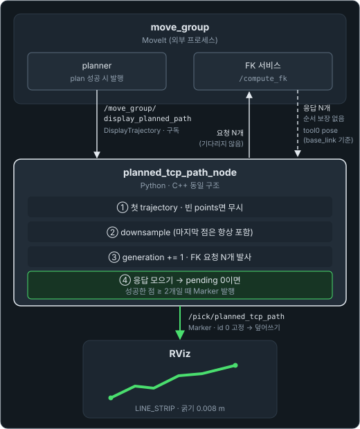
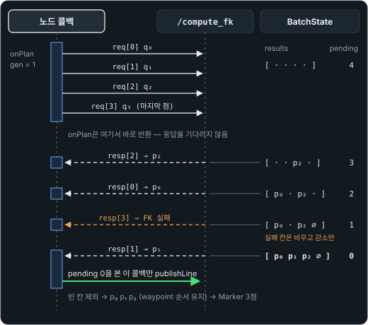
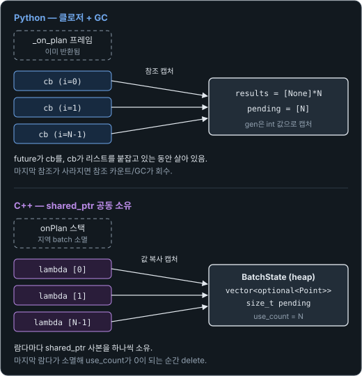
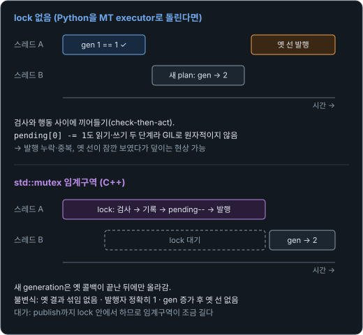

> [!PROMPT]
> 프로그래밍 실무 학습을 위한 코드 분석 요청. '/home/kimkh/cobot2_ws/src/planned_tcp_path_cpp/src/planned_tcp_path_node.cpp'  . '/home/kimkh/cobot2_ws/src/pick_fsm/pick_fsm/planned_tcp_path_node.py' 각각 어떤 라이브러리, 어떤 동작을 목표로 코드를 구성했는지 설명하고 최종적으로 각 언어 코드들의 장단점과 차이점, 특징을 해설해줘

> [!NOTE]
> ChatGPT 답변이 아니라 로컬 Claude Code 세션이 두 소스 파일을 읽고 쓴 해설입니다. 원래 단독 HTML 페이지(그림 4개·Python/C++ 좌우 코드 대조)로 만든 것을 이 사이트 형식으로 옮겼습니다. 옮기면서 좌우 코드 대조는 위(Python)·아래(C++) 순서로 바꿨고, 그림 4개는 이 사이트의 글 폭에 맞게 세로 배치로 다시 그렸습니다(정보는 같고, 라벨 일부는 나누거나 짧게 줄임). 코드의 줄 번호(`py:39-45` 등)는 작성 시점(2026-11-21) 기준입니다. 원래 HTML 끝에 있던 관련 종합본 참조(`md/python-vs-cpp-porting.md`, 사이트 밖 cobot2_ws 문서)는 링크할 수 없어 이 글에는 넣지 않았고, 대신 글 끝에 이 사이트의 멀티스레딩 글 링크를 새로 달았습니다.

# planned_tcp_path 노드 해부

move_group이 계획한 관절 궤적을 `/compute_fk`로 풀어, TCP가 지나갈 선을 RViz에 그리는 노드입니다. 같은 기능을 Python 원본과 C++ 포팅이 각각 어떻게 짰는지, 그리고 언어 차이가 코드 어디에 드러나는지 따라갑니다.

- Python: `src/pick_fsm/pick_fsm/planned_tcp_path_node.py` · 126줄
- C++: `src/planned_tcp_path_cpp/src/planned_tcp_path_node.cpp` · 214줄

## 1. 관절 궤적이 TCP 선이 되기까지

노드는 `move_group`의 실행 흐름에 끼어들지 않고 옆에서 지켜보기만 합니다. 계획이 성공할 때마다 나오는 `display_planned_path`를 받아서, waypoint마다 순방향기구학(FK)을 move_group에 맡기고, 돌아온 tool0 위치를 이어 선으로 만듭니다.



그림 1. 노드는 토픽 하나를 구독하고, 서비스 하나를 N번 부르고, 토픽 하나를 발행합니다. 로봇을 움직이는 경로(액션·execute)는 전혀 건드리지 않습니다.

## 2. fan-out / fan-in

요청 N개를 한꺼번에 보내는 것이 fan-out, 응답을 같은 결과 묶음(batch)에 모으는 것이 fan-in입니다. 응답은 보낸 순서대로 돌아온다는 보장이 없어서, 각 응답은 자기 인덱스 칸에 결과를 적고 `pending`을 하나 줄입니다. `pending`을 0으로 만든 콜백 하나만 선을 발행합니다.



그림 2. 응답 도착 순서(2 → 0 → 3 → 1)와 상관없이 결과는 인덱스 칸에 들어가므로 선의 순서가 섞이지 않습니다. 이 예시에서 응답 순서와 실패 칸은 설명을 위해 정한 값입니다.

> [!TIP]
> **generation이 막는 것** — 4개 중 2개만 돌아온 상태에서 새 plan이 오면 `generation`이 2가 됩니다. 늦게 도착한 옛 응답 2개는 콜백 첫 줄의 `gen != generation` 검사에서 버려지고, 옛 batch는 발행되지 않은 채 끝납니다.

> [!TIP]
> **왜 응답을 기다리지 않나** — 단일 스레드 executor 안에서 콜백이 서비스 응답을 블로킹으로 기다리면, 응답을 처리할 스레드가 그 콜백 자신이라 멈춥니다. 비동기로 보내고 콜백에서 받는 구조가 이 문제를 피하고, N번 왕복도 겹쳐서 처리합니다.

## 3. 설계 포인트 — 각 결정이 노리는 것

| 결정 | 의도 |
|---|---|
| `display_planned_path`만 구독 | task_manager·moveit_bridge의 실행 흐름을 건드리지 않는 관찰자 노드 (py:8) |
| FK를 `/compute_fk`에 맡김 | URDF·kinematics 플러그인을 노드에 싣지 않고 move_group이 가진 RobotModel을 그대로 씀 |
| 비동기 요청 N개 | 왕복 시간을 겹치고, 콜백 안 블로킹 대기로 생기는 데드락을 피함 |
| `generation` 번호 | 겹쳐 들어온 이전 plan의 FK 결과가 새 선을 덮지 않게 함 |
| `marker.id = 0` 고정 | 같은 ns/id라서 RViz가 이전 선을 덮어씀. 지우는 메시지를 따로 보낼 필요 없음 |
| 성공한 점 < 2이면 발행 안 함 | LINE_STRIP은 점 2개부터 의미가 있음. 경고 로그만 남김 |
| 마지막 waypoint 항상 포함 | downsample 간격과 상관없이 마지막 점도 FK 요청에 넣어, 그 FK가 성공하면 선이 실제 목표 자세에서 끝나게 함(실패하면 그 점은 빠짐) |
| 파라미터 3개 | `base_frame`(base_link) · `tip_link`(tool0) · `downsample`(1). 시작할 때 한 번 읽고, 실행 중 변경 콜백은 없음 |

## 4. 라이브러리 구성

| 역할 | Python · pick_fsm | C++ · planned_tcp_path_cpp |
|---|---|---|
| ROS 클라이언트 | `rclpy` — `Node`, `ReentrantCallbackGroup` | `rclcpp` — `rclcpp::Node` |
| 메시지·서비스 | `moveit_msgs` (DisplayTrajectory, RobotState, GetPositionFK), `sensor_msgs.JointState`, `std_msgs.ColorRGBA`, `visualization_msgs.Marker` | 같은 패키지의 C++ 헤더 + `geometry_msgs::msg::Point`, `MoveItErrorCodes` |
| 언어 표준 도구 | list, slice `[::n]`, 클로저 | `std::vector`, `std::optional`, `std::shared_ptr`, `std::mutex`, 람다 |
| 빌드·등록 | `setup.py` entry_points. 컴파일 없음 | `CMakeLists.txt`: `find_package` → `add_executable` → `ament_target_dependencies` → `install`. `-Wall -Wextra -Wpedantic` |

## 5. 같은 단계, 두 언어

실행 순서대로 여섯 단계를 차례로 놓았습니다. 코드는 두 파일에서 발췌했고, 단계마다 Python 다음에 C++이 옵니다. 지면상 일부 줄(파라미터 값 읽기, 반복문 머리, 후속 처리 등)을 생략하고 줄바꿈·주석을 줄인 곳이 있습니다. 괄호 안 숫자는 줄 번호입니다.

### 5.1 파라미터 선언

Python (py:39-45)

```python
self.declare_parameter('base_frame', 'base_link')
self.declare_parameter('tip_link', 'tool0')
self.declare_parameter('downsample', 1)

self.downsample = max(1, int(
    self.get_parameter('downsample').value))
```

C++ (cpp:40-46)

```cpp
declare_parameter<std::string>("base_frame", "base_link");
declare_parameter<std::string>("tip_link", "tool0");
declare_parameter<int64_t>("downsample", 1);

downsample_ = std::max<int64_t>(
  1, get_parameter("downsample").as_int());
```

Python은 기본값을 보고 타입을 정하고, `.value`를 `int()`로 한 번 더 감쌉니다. C++은 템플릿 인자로 타입을 적고 `as_int()`로 꺼냅니다. 타입 의도가 선언 줄에 그대로 보입니다.

### 5.2 downsample과 마지막 점

Python (py:62-64)

```python
points = list(jt.points)[::self.downsample]
if points[-1] is not jt.points[-1]:
    points.append(jt.points[-1])
```

C++ (cpp:90-98)

```cpp
std::vector<std::size_t> selected_indices;
const auto step = static_cast<std::size_t>(downsample_);
for (std::size_t index = 0;
     index < trajectory_points.size(); index += step) {
  selected_indices.push_back(index);
}
const std::size_t last_index = trajectory_points.size() - 1;
if (selected_indices.back() != last_index) {
  selected_indices.push_back(last_index);
}
```

Python은 slice 한 줄로 끝내고, 마지막 점이 들어갔는지를 **객체 동일성**(`is not`)으로 판정합니다. slice가 원소 참조를 그대로 담기 때문에 통하는 방법입니다. C++은 인덱스 목록을 직접 만들고 정수로 비교합니다. 코드는 길지만 무엇을 비교하는지가 분명합니다.

### 5.3 요청 보내기와 콜백 등록 (fan-out)

Python (py:71-80)

```python
for i, pt in enumerate(points):
    req = GetPositionFK.Request()
    req.header.frame_id = self.base_frame
    req.fk_link_names = [self.tip_link]
    req.robot_state = RobotState()
    req.robot_state.joint_state = JointState()
    req.robot_state.joint_state.name = list(jt.joint_names)
    req.robot_state.joint_state.position = list(pt.positions)
    fut = self.fk.call_async(req)
    fut.add_done_callback(
        self._make_fk_done(gen, i, results, pending))
```

C++ (cpp:114-127)

```cpp
auto request = std::make_shared<
  moveit_msgs::srv::GetPositionFK::Request>();
request->header.frame_id = base_frame_;
request->fk_link_names = {tip_link_};
request->robot_state.joint_state.name =
  joint_trajectory.joint_names;
request->robot_state.joint_state.position = point.positions;

fk_client_->async_send_request(
  request,
  [this, generation, result_index, batch](
    rclcpp::Client<...>::SharedFuture future) {
    onFkDone(generation, result_index, batch, future);
  });
```

Python은 future를 받은 뒤 `add_done_callback`으로 콜백을 붙이는 두 단계입니다. C++은 `async_send_request(request, callback)` 한 번으로 보내기와 등록을 같이 합니다. 어느 쪽도 polling하지 않고, executor가 응답을 받으면 콜백을 실행합니다. C++ 코드의 `...`는 지면상 줄인 부분입니다(원문은 `moveit_msgs::srv::GetPositionFK`).

### 5.4 공유 상태 담기 (fan-in 준비)

Python (py:66-69, 82-92)

```python
self._generation += 1
gen = self._generation
results = [None] * len(points)
pending = [len(points)]  # 클로저에서 재할당하려고 리스트로 감쌈

def _make_fk_done(self, gen, i, results, pending):
    def cb(fut):
        ...
        pending[0] -= 1
    return cb
```

C++ (cpp:66-75, 109)

```cpp
struct BatchState {
  explicit BatchState(std::size_t size)
  : results(size), pending(size) {}

  std::vector<std::optional<
    geometry_msgs::msg::Point>> results;
  std::size_t pending;
};

auto batch = std::make_shared<BatchState>(
  selected_indices.size());
```

이 포팅에서 가장 배울 게 많은 단계입니다. 자세한 수명 비교는 6절에 그림으로 있습니다.

- `pending = [n]`: 안쪽 함수에서 `pending -= 1`이라고 쓰면 그 이름이 지역 변수로 새로 묶여 `UnboundLocalError`가 납니다. 리스트에 담으면 재할당이 아니라 원소 변경이 됩니다. `nonlocal`로도 풀 수 있습니다.
- `std::optional<Point>`는 Python의 "None 또는 Point" 칸에 1:1로 대응합니다.

### 5.5 응답 처리 (fan-in)

Python (py:83-91)

```python
def cb(fut):
    if gen != self._generation:
        return  # 새 plan이 들어와서 버린다
    resp = fut.result()
    if (resp is not None
            and resp.error_code.val == resp.error_code.SUCCESS
            and resp.pose_stamped):
        results[i] = resp.pose_stamped[0].pose.position
    pending[0] -= 1
    if pending[0] == 0:
        self._publish_line(results)
```

C++ (cpp:142-159)

```cpp
std::lock_guard<std::mutex> lock(state_mutex_);
if (generation != generation_) {
  return;
}
const auto response = future.get();
if (response &&
    response->error_code.val ==
      moveit_msgs::msg::MoveItErrorCodes::SUCCESS &&
    !response->pose_stamped.empty()) {
  batch->results[result_index] =
    response->pose_stamped.front().pose.position;
}
--batch->pending;
if (batch->pending == 0) {
  publishLine(batch->results);
}
```

로직은 한 줄씩 대응합니다. 차이는 C++ 첫 줄의 `lock_guard` 하나입니다. 검사, 기록, 감소, 발행이 모두 한 임계구역 안에 들어갑니다. 왜 필요한지는 7절에서 다룹니다.

### 5.6 Marker 만들기

Python (py:95-110)

```python
pts = [p for p in results if p is not None]
if len(pts) < 2:
    self.get_logger().warn(...)
    return
m = Marker()
m.header.frame_id = self.base_frame
m.header.stamp = self.get_clock().now().to_msg()
m.ns = 'planned_tcp_path'
m.id = 0
m.type = Marker.LINE_STRIP
m.scale.x = 0.008
m.color = ColorRGBA(r=0.1, g=0.9, b=0.2, a=0.9)
m.points = pts
self.marker_pub.publish(m)
```

C++ (cpp:164-193)

```cpp
std::vector<geometry_msgs::msg::Point> points;
points.reserve(results.size());
for (const auto & result : results) {
  if (result.has_value()) points.push_back(*result);
}
if (points.size() < 2) { RCLCPP_WARN(...); return; }

visualization_msgs::msg::Marker marker;
marker.header.frame_id = base_frame_;
marker.header.stamp = now();
marker.color.r = 0.1F; marker.color.g = 0.9F;
marker.color.b = 0.2F; marker.color.a = 0.9F;
marker.points = std::move(points);
marker_pub_->publish(marker);
```

Python은 리스트 컴프리헨션과 키워드 인자 생성자로 짧게 씁니다. C++은 `reserve`로 재할당을 막고, `std::move`로 점 배열을 복사 없이 넘깁니다. `now()`가 돌려주는 `rclcpp::Time`은 메시지의 시간 타입으로 자동 변환됩니다. 양쪽 모두 일부 줄(`action`, `lifetime` 등)은 생략했습니다.

## 6. 공유 상태와 수명

`onPlan`은 요청을 보낸 즉시 반환합니다. 그런데 결과 칸과 `pending`은 마지막 응답이 올 때까지 살아 있어야 합니다. 함수가 끝난 뒤에도 상태를 살려 두는 방법이 두 언어에서 다릅니다.



그림 3. 구조는 같습니다. N개의 콜백이 하나의 상태 묶음을 함께 붙잡습니다. Python은 런타임이 수명을 추적하고, C++은 `shared_ptr`이라는 타입으로 소유권을 코드에 적습니다.

> [!WARNING]
> **C++ 람다의 `[this]`** — 람다는 `batch`는 값으로 소유하지만 노드는 `this` 포인터로만 잡습니다. 노드가 콜백보다 오래 산다는 전제에 기대는 것입니다. 이 노드는 client를 자기가 소유하고 노드가 사라지면 client도 함께 사라지므로 성립합니다. 구조를 바꿀 때 다시 따져야 하는 지점입니다.

## 7. 동시성: 지금은 같고, executor를 바꾸면 갈린다

두 노드 모두 `spin(node)`로 돌기 때문에 SingleThreadedExecutor를 씁니다. 콜백이 한 번에 하나씩만 실행되므로 지금은 둘 다 맞게 동작합니다. Python 쪽 `ReentrantCallbackGroup`은 단일 스레드 executor에서는 효과가 없습니다. 차이는 MultiThreadedExecutor로 옮겼을 때 나타납니다.



그림 4. 아래쪽의 세 불변식은 C++ 소스 주석(cpp:138-141)에 적힌 그대로입니다. 위쪽은 Python 코드를 그대로 MultiThreadedExecutor에 올렸다고 가정한 시나리오이며, 실행해서 재현한 것은 아닙니다.

## 8. 알고 쓰면 되는 한계 (두 코드 공통)

- **`wait_for_service`가 없습니다.** move_group이 뜨기 전에 plan이 들어오면 응답이 오지 않아 그 batch는 발행되지 않습니다. 다음 plan이 오면 generation이 바뀌고, 그 plan의 FK가 성공하면 새 선(id 0)이 덮어써서 복구됩니다. 그 전까지는 이전 선이 그대로 남아 있을 수 있습니다(Marker lifetime 0 = 덮어쓸 때까지 표시).
- **타임아웃이 없습니다.** FK 실패는 응답으로 돌아오므로 괜찮지만, 응답 자체가 유실되면 그 요청은 client 내부 대기 목록에 남습니다. rclcpp Humble에는 이를 정리하는 `prune_pending_requests()`·`prune_requests_older_than()`가 있는데 이 코드는 쓰지 않습니다.
- **전제가 실기에서 확인되지 않았습니다.** plan+execute 조합 액션에서도 `display_planned_path`가 매번 나온다는 전제는 원본 docstring에 UNVERIFIED로 적혀 있습니다(py:20). 실기에서 `ros2 topic hz /move_group/display_planned_path`로 먼저 확인할 것을 권합니다.
- **파라미터는 시작할 때만 읽습니다.** 실행 중 `ros2 param set`을 해도 반영되지 않습니다.

## 9. 장단점과 결론

| 관점 | Python (rclpy) | C++ (rclcpp) |
|---|---|---|
| 분량·가독성 | 126줄. slice·클로저·키워드 생성자로 짧음 | 214줄. 타입·헤더·소유권을 적어야 해서 길지만 의도가 코드에 드러남 |
| 타입 안전성 | 런타임에 발견 (`int()` 변환, None 체크) | 타입 오류는 컴파일 타임에 발견. `optional`이 빈 값 가능성을 타입에 드러냄(검사는 `has_value()`로 개발자가 함) |
| 메모리·수명 | GC가 관리. 신경 쓸 일이 거의 없음 | `shared_ptr`로 명시. `[this]`는 노드 수명 전제에 기댐 |
| 동시성 | GIL이 있어도 복합 연산은 원자적이지 않음. 진짜 병렬 실행 이점은 작음 | mutex로 MT executor에서도 안전. 대신 직접 설계해야 하고 실수 여지가 큼 |
| 성능 | 메시지 변환·콜백 오버헤드가 큼 | 오버헤드가 작고 component(intra-process)로 합칠 수 있음 |
| 개발 사이클 | `--symlink-install`이면 고치고 바로 실행 | 고칠 때마다 컴파일. 대신 `-Wall` 경고가 버그를 미리 잡음 |
| 실패 양상 | 오타·타입 오류가 런타임 예외로 노드를 멈춤 | 컴파일 에러로 사전 차단. 대신 dangling 참조 같은 UB는 조용히 남을 수 있음 |

> [!IMPORTANT]
> **이 노드에서는 Python으로 충분합니다** — 병목은 언어가 아니라 move_group이 처리하는 FK N회 왕복입니다. plan이 나올 때만 도는 저빈도 시각화 노드라서 C++로 옮겨도 체감 이득은 거의 없습니다. C++ 포팅의 가치는 학습에 있습니다. 클로저를 `shared_ptr` 람다로, None을 `optional`로, 암묵적인 단일 스레드 가정을 명시적인 mutex 불변식으로 바꾸는 연습입니다. 반대로 depth downsample처럼 프레임마다 도는 센서 처리라면 C++의 이점이 실제 수치로 나타날 가능성이 큽니다.

관련 글: [멀티스레딩(Multithreading)의 개념과 Python·ROS 2 노드 최적화](python-ros2-multithreading.html) — Executor·Callback Group 구성을 더 자세히 다룹니다.
