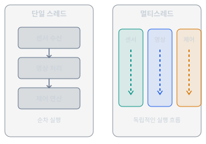
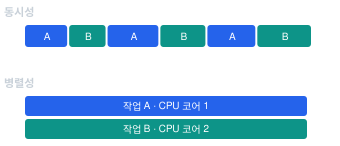
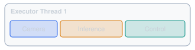
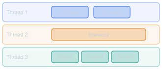

> [!PROMPT]
> 멀티쓰레드 용어 설명. 또한 python코드 등, 노드의 멀티쓰레드를 통한 최적화에 대해 설명.

> [!NOTE]
> ChatGPT 답변 공유 링크에서 가져온 원문입니다. 문장·표·코드는 바꾸지 않았습니다. 화면에 그려진 그림 4개는 공유 페이지에 들어 있던 SVG 원본을 파일로 옮겼고(어두운 배경에서 보이도록 글자색만 변경), 실행 빈도 차트는 원문 데이터를 표로, 아키텍처 카드는 같은 글자를 레이아웃 태그로 다시 배치했습니다(아이콘은 원본 이름을 확인하지 못해 화살표만 남김). 5.3 코드 블록은 화면에 보이는 코드(빈 줄 포함)를 기준으로 했습니다. 답변 끝의 후속 질문 제안 목록은 뺐습니다. 첫 문단의 `**` 표시는 원문 화면에도 그대로 보이는 표기입니다.

# 멀티스레딩(Multithreading)의 개념과 Python·ROS 2 노드 최적화

\*\*멀티스레딩(Multithreading)\*\*은 하나의 프로세스(Process) 안에서 여러 실행 흐름인 스레드(Thread)를 사용해 작업을 동시성 있게 처리하는 프로그래밍 기법입니다.

로보틱스에서는 특히 **센서 데이터 수신, 영상 처리, AI 추론, 경로 계획, 로봇 제어**처럼 서로 다른 주기와 처리 시간이 필요한 작업을 효율적으로 운영하는 데 활용됩니다.

다만 중요한 점은 **멀티스레딩을 적용한다고 반드시 처리 속도나 FPS가 증가하는 것은 아니라는 것**입니다. Python의 GIL, CPU 코어 수, 작업의 성격, ROS 2 Executor 구성에 따라 성능 개선 효과가 달라집니다.

## 1\. 프로세스와 스레드의 차이

단일 스레드와 멀티스레드 구조



개념도: 멀티스레드는 작업의 진행을 겹칠 수 있지만, 모든 작업이 실제로 동시에 CPU에서 실행된다는 뜻은 아닙니다.

| 구분 | 프로세스(Process) | 스레드(Thread) |
|--------|--------|--------|
| 정의 | 실행 중인 프로그램의 독립 실행 단위 | 프로세스 내부의 실행 흐름 |
| 메모리 | 기본적으로 독립 주소 공간 | 같은 프로세스의 메모리 공유 |
| 생성 비용 | 상대적으로 큼 | 상대적으로 작음 |
| 데이터 교환 | IPC, 소켓, 공유 메모리 등 | 공유 객체, 큐 등 |
| 장애 영향 | 대체로 프로세스 단위 격리 | 스레드 오류가 프로세스 전체에 영향 가능 |
| Python 구현 | `multiprocessing` | `threading` |

예를 들어 ROS 2에서 카메라 노드, YOLO 추론 노드, 제어 노드를 각각 실행하면 일반적으로 서로 다른 프로세스로 동작합니다. 반면 하나의 Python 노드에서 카메라 콜백과 제어 콜백을 여러 스레드로 처리한다면 멀티스레딩에 해당합니다.

## 2\. 동시성(Concurrency)과 병렬성(Parallelism)

이 둘은 멀티스레딩을 이해하는 핵심 개념입니다.

작업 A·B의 실행 타임라인



- **동시성\:** 여러 작업을 번갈아 수행하거나 대기 시간을 활용해 함께 진행시키는 것.
- **병렬성\:** 여러 CPU 코어 등에서 실제로 여러 작업을 같은 시점에 실행하는 것.

멀티스레딩은 동시성을 구현하는 대표적인 방법이며, 실행 환경에 따라 병렬성도 제공할 수 있습니다.

## 3\. Python에서 멀티스레딩이 가지는 한계: GIL

일반적인 CPython 환경에는 \*\*GIL(Global Interpreter Lock)\*\*이라는 메커니즘이 있습니다.

전통적인 GIL 활성화 CPython에서는 하나의 인터프리터 내에서 한 시점에 하나의 스레드만 Python 바이트코드를 실행할 수 있습니다.

따라서 다음과 같은 차이가 발생합니다.

| 작업 유형 | 멀티스레딩 효과 | 이유 |
|--------|--------|--------|
| 센서·네트워크 I/O | 높음 | 수신 대기 중 다른 작업 진행 |
| 파일 읽기·쓰기 | 높을 수 있음 | I/O 대기 시간 중첩 |
| Python 반복문 기반 연산 | 낮음 | GIL 경합 |
| NumPy/OpenCV | 상황에 따라 높음 | 일부 네이티브 연산이 GIL 해제 |
| PyTorch GPU 추론 | 상황에 따라 높음 | GPU 연산과 CPU 작업 중첩 가능 |
| 순수 Python CPU 집약 연산 | 멀티프로세싱 유리 | 여러 코어에서 별도 인터프리터 실행 |

참고로 Python 3.13부터 선택적인 free-threaded 빌드가 도입되어 GIL 없이 실행할 수 있는 환경도 있습니다. 다만 일반적인 Python 3.10 기반 ROS 2 Humble 환경에서는 기존 GIL 모델을 기준으로 이해하는 것이 적절합니다.

## 4\. Python 멀티스레딩 코드 예제

### 4.1 단일 스레드 방식

센서 데이터를 수신하고, 처리한 뒤, 제어 명령을 생성한다고 가정하겠습니다.


```python
import time

def read_sensor():
    time.sleep(0.1)  # 센서 수신 대기

def process_data():
    time.sleep(0.2)  # 처리 시간 가정

def control_robot():
    time.sleep(0.05)  # 제어 명령 처리

while True:
    read_sensor()
    process_data()
    control_robot()
```


세 작업이 순차적으로 실행되므로 한 사이클에 약 350ms가 필요합니다.

이 경우 처리율은 이론적으로 약 2.86Hz입니다.

### 4.2 멀티스레드 방식


```python
import threading
import time

def sensor_task():
    while True:
        print("센서 데이터 수신")
        time.sleep(0.1)

def processing_task():
    while True:
        print("데이터 처리")
        time.sleep(0.2)

def control_task():
    while True:
        print("로봇 제어")
        time.sleep(0.05)

threads = [
    threading.Thread(target=sensor_task),
    threading.Thread(target=processing_task),
    threading.Thread(target=control_task)
]

for thread in threads:
    thread.start()

for thread in threads:
    thread.join()
```


세 스레드는 서로 독립적으로 진행됩니다. 위 예제는 실제 센서 데이터를 전달하지 않고, 작업 실행 구조만 보여줍니다.

각 작업이 대부분 대기하는 예제이므로 서로 겹쳐 진행할 수 있습니다.

<box gap={2}>
  <text weight="medium" size="sm">이론적 실행 빈도 비교</text>
  <caption>sleep으로 모사한 이상적인 작업 주기. 실제 CPU 계산 성능을 의미하지 않음.</caption>
  <Chart content={{"chartType":"bar","meta":{"description":"sleep으로 모사한 이상적인 작업 주기. 실제 CPU 계산 성능을 의미하지 않음."},"xKey":"task","series":[{"dataKey":"hz","label":"실행 빈도","valueSuffix":" Hz","axisId":"hz"}],"yAxisMin":0,"data":[{"task":"순차 사이클","hz":2.86},{"task":"센서 스레드","hz":10},{"task":"처리 스레드","hz":5},{"task":"제어 스레드","hz":20}],"formattedData":[{"task":"순차 사이클","hz":"2.86 Hz"},{"task":"센서 스레드","hz":"10 Hz"},{"task":"처리 스레드","hz":"5 Hz"},{"task":"제어 스레드","hz":"20 Hz"}],"axes":[{"id":"hz","dimension":"y","domain":[0,24],"ticks":[{"value":0,"label":"0 Hz"},{"value":6,"label":"6 Hz"},{"value":12,"label":"12 Hz"},{"value":18,"label":"18 Hz"},{"value":24,"label":"24 Hz"}]}]}}/>
  <caption>운영체제 스케줄링 지연과 작업 간 데이터 의존성을 제외한 예시입니다.</caption>
</box>

하지만 실제 로봇에서는 센서 데이터가 준비되어야 처리할 수 있고, 처리 결과가 있어야 제어 명령을 생성할 수 있습니다. 따라서 각 스레드를 단순히 무한 반복시키는 것만으로는 올바른 시스템이 완성되지 않습니다.

### 4.3 실무에서는 Queue를 활용

스레드 간 데이터를 안전하게 전달할 때는 `queue.Queue`를 활용할 수 있습니다.


```python
import threading
import queue
import time

sensor_queue = queue.Queue(maxsize=1)
stop_event = threading.Event()

def sensor_thread():
    while not stop_event.is_set():
        data = read_sensor()

        # 오래된 데이터를 버리고 최신 데이터 유지
        try:
            sensor_queue.put_nowait(data)
        except queue.Full:
            try:
                sensor_queue.get_nowait()
            except queue.Empty:
                pass
            try:
                sensor_queue.put_nowait(data)
            except queue.Full:
                pass

def processing_thread():
    while not stop_event.is_set():
        try:
            data = sensor_queue.get(timeout=0.1)
        except queue.Empty:
            continue

        result = process_data(data)
        publish_result(result)
```


위 코드는 데이터 전달 구조 예시이며 `read_sensor`, `process_data`, `publish_result`는 실제 구현이 필요한 함수입니다.

`maxsize=1`은 로보틱스에서 특히 의미가 있습니다. 카메라 영상처럼 최신 상태가 중요한 데이터는 오래된 프레임을 계속 처리하기보다 버리는 편이 유리할 수 있기 때문입니다.

다만 모든 데이터에 이 전략을 적용하면 안 됩니다. IMU 적분, 센서 동기화, 로그 기록처럼 연속된 샘플이 중요한 경우에는 데이터 손실을 별도로 관리해야 합니다.

---

# 5\. ROS 2 노드에서 멀티스레딩을 활용하는 방법

ROS 2에서는 Python `threading`을 직접 사용하는 것 외에도 **Executor와 Callback Group**을 이용해 콜백 실행 방식을 제어할 수 있습니다.

## 5.1 ROS 2 Executor란?

Executor는 Subscription, Timer, Service 등의 콜백이 실행될 수 있도록 스케줄링하고 실행하는 구성 요소입니다.

대표적으로 두 종류가 있습니다.

| 구분 | SingleThreadedExecutor | MultiThreadedExecutor |
|--------|--------|--------|
| 실행 스레드 | 1개 | 여러 개 |
| 콜백 동시 실행 | 불가 | 조건부 가능 |
| 구현 복잡도 | 낮음 | 상대적으로 높음 |
| 주요 장점 | 단순성, 실행 흐름 추적 | 콜백 응답성 개선 |
| 주요 위험 | 긴 콜백이 다른 콜백 차단 | 경쟁 상태, 자원 경합 |

### SingleThreadedExecutor



추론 콜백이 오래 실행되면 제어 콜백도 대기합니다.

### MultiThreadedExecutor



서로 다른 콜백을 겹쳐 실행할 수 있습니다. 단, Callback Group 설정이 이를 허용해야 합니다.

## 5.2 Callback Group이 중요한 이유

ROS 2에는 대표적으로 두 종류의 Callback Group이 있습니다.

**MutuallyExclusiveCallbackGroup**

- 같은 그룹 내의 콜백은 동시에 실행되지 않습니다.
- 공유 상태에 대한 동시 접근을 제한할 때 유리합니다.
- Python ROS 2 노드의 기본 콜백 그룹 유형입니다.

**ReentrantCallbackGroup**

- 같은 그룹 내 콜백도 동시에 실행될 수 있습니다.
- 동일한 콜백이 중첩 실행되는 것도 허용합니다.
- 공유 데이터에 대한 동기화가 필요할 수 있습니다.

중요한 사실은 `MultiThreadedExecutor`만 선언하고 모든 콜백을 기본 MutuallyExclusive 그룹에 두면, **해당 노드의 콜백이 사실상 직렬 실행될 수 있다는 것**입니다.

## 5.3 ROS 2 Python 멀티스레드 노드 예제

아래 코드는 센서 처리와 제어 타이머가 서로 다른 스레드에서 실행될 수 있도록 구성한 예제입니다.

```python
import time
import rclpy

from rclpy.node import Node
from rclpy.executors import MultiThreadedExecutor
from rclpy.callback_groups import MutuallyExclusiveCallbackGroup
from std_msgs.msg import String


class RobotNode(Node):
    def __init__(self):
        super().__init__('robot_node')

        # 서로 다른 콜백 그룹
        self.sensor_group = MutuallyExclusiveCallbackGroup()
        self.control_group = MutuallyExclusiveCallbackGroup()

        self.subscription = self.create_subscription(
            String,
            '/sensor_data',
            self.sensor_callback,
            10,
            callback_group=self.sensor_group
        )

        self.timer = self.create_timer(
            0.02,  # 50Hz 제어 타이머
            self.control_callback,
            callback_group=self.control_group
        )

    def sensor_callback(self, msg):
        self.get_logger().info('Sensor processing')
        time.sleep(0.1)  # I/O 대기 모사

    def control_callback(self):
        self.get_logger().info('Control callback')


def main():
    rclpy.init()

    node = RobotNode()
    executor = MultiThreadedExecutor(num_threads=2)
    executor.add_node(node)

    try:
        executor.spin()
    finally:
        executor.shutdown()
        node.destroy_node()
        rclpy.shutdown()


if __name__ == '__main__':
    main()
```

이 예제에서 중요한 부분은 다음 두 가지입니다.

1. `MultiThreadedExecutor(num_threads=2)`로 콜백을 실행할 스레드 풀을 구성합니다.
2. 센서와 제어 콜백을 서로 다른 Callback Group에 배치해 동시 실행 가능성을 확보합니다.

따라서 센서 콜백이 100ms 동안 대기하더라도 제어 타이머는 다른 스레드에서 실행될 수 있습니다.

단, 50Hz 타이머를 설정했다는 사실만으로 20ms 주기가 보장되는 것은 아닙니다. 실제 주기에는 운영체제 스케줄링, GIL, 다른 콜백의 실행 시간 등이 영향을 미칩니다.

---

# 6\. 실제 로보틱스 시스템에서의 최적화 사례

ROS 2 + RealSense D435i + YOLO + 로봇 제어 환경을 예시로 보겠습니다.

## 6.1 영상 인식과 로봇 제어의 분리

<box border radius="xl" padding={3} gap={2}>
  <text color="secondary" weight="medium" size="xs">권장 아키텍처 예시</text>
  <box background="surface-secondary" radius="lg" padding={3} align=center gap={1}>
    <text weight="semibold">RealSense Camera</text>
    <caption>30 FPS · 이미지 발행</caption>
  </box>
  <row justify=center>
    <icon name="arrow-down" color="tertiary"/>
  </row>
  <grid columns={2} gap={2}>
    <grid-item>
      <box border radius="lg" padding={3} align=center gap={1}>
        <text>YOLO 추론 노드</text>
        <caption>GPU 추론 · 예: 10 FPS</caption>
      </box>
    </grid-item>
    <grid-item>
      <box border radius="lg" padding={3} align=center gap={1}>
        <text>상태 모니터링</text>
        <caption>센서·로봇 상태 수신</caption>
      </box>
    </grid-item>
  </grid>
  <row justify=center>
    <icon name="arrow-down" color="tertiary"/>
  </row>
  <box background="surface-secondary" radius="lg" padding={3} align=center gap={1}>
    <text weight="semibold">상위 판단·제어 노드</text>
    <caption>최신 인식 결과 사용 · 예: 50Hz 제어</caption>
  </box>
  <row justify=center>
    <icon name="arrow-down" color="tertiary"/>
  </row>
  <box background="surface-secondary" radius="lg" padding={3} align=center gap={1}>
    <text weight="semibold">로봇 컨트롤러</text>
    <caption>실제 구동 및 하위 제어</caption>
  </box>
  <caption>FPS와 주기는 구조 설명을 위한 가정값입니다. 제어 노드의 50Hz는 새로운 YOLO 결과가 50회 생성된다는 뜻이 아닙니다.</caption>
</box>

이 구조에서는 YOLO 추론이 100ms 걸리더라도 상위 제어 노드가 반드시 100ms마다 실행되어야 하는 것은 아닙니다.

제어 노드는 마지막으로 수신한 인식 결과를 활용해 20ms마다 제어 로직을 실행할 수 있습니다. 다만 인식 결과가 오래되었다면 timeout을 적용해 안전하게 대응해야 합니다.

## 6.2 멀티스레딩 적용 전후의 기대 효과

| 성능 지표 | 단일 실행 흐름 | 적절히 분리한 구조 |
|--------|--------|--------|
| 영상 추론 중 제어 실행 | 차단될 수 있음 | 독립 실행 가능 |
| 센서 콜백 응답성 | 긴 콜백에 영향 | 개선 가능 |
| YOLO 모델 자체 추론 속도 | 기존 속도 | 반드시 빨라지지는 않음 |
| CPU 사용률 | 특정 코어 집중 가능 | 분산 가능 |
| 제어 주기 안정성 | 다른 작업에 종속 | 개선 가능, 보장 아님 |
| 구현 복잡성 | 낮음 | 동기화·데이터 관리 필요 |

특히 YOLO 추론이 병목이라면 멀티스레딩보다 모델 경량화, TensorRT, 입력 해상도 조정, GPU 활용률 분석이 더 효과적일 수 있습니다.

# 7\. 멀티스레딩 외의 최적화 방법

로보틱스에서 중요한 것은 단순히 스레드 수를 늘리는 것이 아니라, **병목 지점에 적합한 동시 실행 구조를 선택하는 것**입니다.

| 방법 | 특징 | 적합한 작업 |
|--------|--------|--------|
| `threading` | 메모리 공유, I/O 동시성 | 센서 수신, 네트워크 |
| `multiprocessing` | 별도 프로세스·GIL 분리 | CPU 집약적 계산 |
| `asyncio` | 비동기 이벤트 루프 | 네트워크·비동기 I/O |
| ROS 2 MultiThreadedExecutor | 콜백 동시 실행 | 센서·타이머·서비스 |
| ROS 2 노드/프로세스 분리 | 독립 실행 및 장애 격리 | 인식·계획·제어 분리 |
| C++ `std::thread` | 네이티브 스레드 실행 | 고성능 연산·실시간성 고려 작업 |

## 8\. 실제 최적화 진행 순서

1. **병목 측정**
   
   콜백 실행 시간, 실제 주기, CPU/GPU 사용률, 메시지 지연을 측정합니다.
2. **작업 특성 분류**
   
   I/O 대기가 많은지, Python CPU 연산이 많은지, GPU 추론이 병목인지 구분합니다.
3. **실행 구조 변경**
   
   콜백 그룹 분리, MultiThreadedExecutor, 별도 프로세스 등을 선택합니다.
4. **데이터 동기화와 안전성 확보**
   
   Lock, Queue, timeout, QoS 등을 활용해 데이터 경쟁과 오래된 데이터 사용을 방지합니다.
5. **변경 전후 성능 검증**
   
   평균 FPS뿐 아니라 지연 시간의 95·99백분위수, 최대 콜백 실행 시간, 제어 주기 편차를 비교합니다.

ROS 2에서는 `ros2_tracing`, `ros2 topic hz`, `ros2 topic bw`, `htop`, GPU 모니터링 도구 등을 활용할 수 있습니다. 단, `ros2 topic hz`의 측정값은 구독 환경과 QoS 등의 영향을 받을 수 있으므로 단독으로 전체 시스템 성능을 판단하면 안 됩니다.

## 9\. 결론: 로봇 노드에 멀티스레딩을 적용해야 할까?

ROS 2 Python 노드에서 멀티스레딩은 **하나의 무거운 작업 때문에 다른 콜백이 실행되지 못하는 현상**을 개선하는 데 특히 유용합니다.

다만 실제 시스템에서는 다음과 같이 구분하는 것을 권장합니다.

- **센서 수신 + 상태 모니터링 + 타이머\:** MultiThreadedExecutor와 Callback Group 분리를 우선 검토
- **YOLO·영상 처리\:** 별도 추론 노드와 최신 프레임 관리, GPU 최적화를 우선 검토
- **CPU 집약적 경로 계획\:** 멀티프로세싱 또는 C++ 기반 병렬 연산 검토
- **고주기 로봇 제어\:** 다른 무거운 콜백과 실행 자원을 분리하고, 주기 안정성 및 최악 지연 시간을 검증

특히 산업용 로봇의 엄격한 실시간 제어에는 일반적인 Python 스레드만으로 결정론적 실행을 보장할 수 없습니다. 하위 제어는 로봇 컨트롤러 또는 적절한 실시간 실행 환경에 맡기고, Python 노드는 상위 제어와 판단을 담당하도록 설계하는 것이 일반적으로 적합합니다.

**핵심은 멀티스레딩이 개별 연산을 빠르게 만드는 기술이라기보다, 여러 작업이 서로를 불필요하게 기다리지 않도록 실행 구조를 개선하는 기술이라는 점입니다.**

---

확신도: 추론(ROS 2·Python의 알려진 실행 모델에 근거한 설명이며, 실제 노드 성능은 미검증)

내가 채워넣은 가정: ROS 2 Humble 및 일반적인 GIL 활성화 CPython 환경을 기준으로 설명함. RealSense·YOLO·제어 노드는 적용 예시로 가정함.

확인 요청: 없음.
