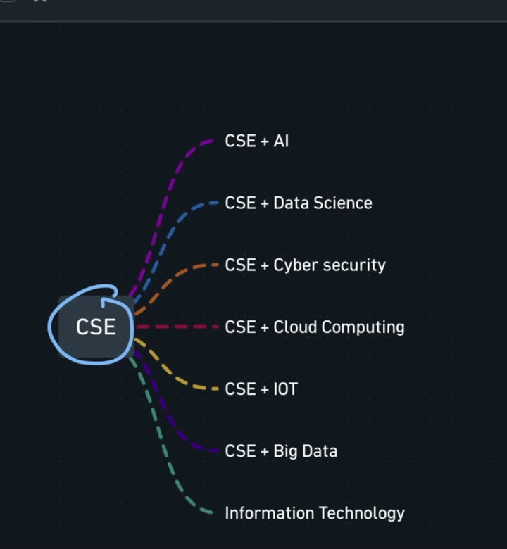
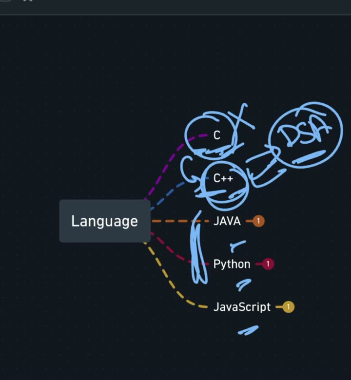
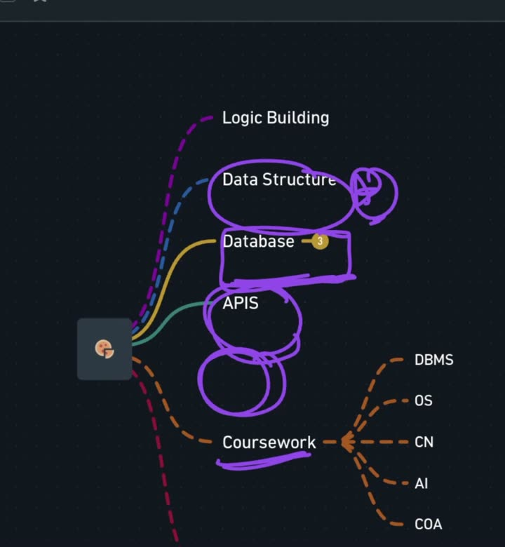

> [!NOTE]
> 이 글은 ChatGPT 원문 Q&A가 아니라, Claude가 Instagram 릴스를 보고 새로 정리한 글입니다. 확보한 것: 캡션, 영상 화면(약 1분 30초, 3초 간격 장면 30장 확인). 확보 못 한 것: **음성(받아쓰기 도구 미설치 — 음성 미반영)**. 그래서 "릴스 요약"은 화면에 보이는 마인드맵 글자와 캡션만 근거로 했고, 화자가 말로 설명한 내용은 반영하지 않았습니다. 장면 캡처 3장은 출처 표기 인용이며 원작자 허락은 받지 않았습니다. 화자 얼굴이 나오는 아래쪽은 잘라 내고 마인드맵 부분만 실었습니다. 질문 원문 없이 링크만 받아 정리한 글입니다.

## 릴스 요약

@codewithnishchal(2026-09-08 게시, 약 1분 30초). 화면 위쪽의 마인드맵에 손글씨로 표시를 더해 가며 설명하는 영상이고, 화면은 세 장면으로 이어집니다. 캡션의 핵심 문장은 다음과 같습니다.

> "Focus on learning computer science first not the specialisation."
> "When your problem-solving skills get strong, you can grind anything you want later on."

**1. CSE 세부 전공 (0:00~0:27)** — 가운데 `CSE` 노드에서 `CSE + AI`, `CSE + Data Science`, `CSE + Cyber security`, `CSE + Cloud Computing`, `CSE + IOT`, `CSE + Big Data`, `Information Technology` 일곱 갈래가 뻗어 있고, 화자가 각 갈래에 밑줄과 괄호를 긋습니다. 캡션의 "specialisation"이 이 갈래들에 해당하는 것으로 보입니다(음성 미확인).

<text color="secondary" size="xs">출처: @codewithnishchal · https://www.instagram.com/reel/DdBlUGiTBqe/ · 0:02 장면</text>

**2. 언어 (0:27~0:54)** — `Language` 노드 아래 `C`, `C++`, `JAVA`, `Python`, `JavaScript`. 화자는 `C`에 X 표시를 하고, `C++`에 동그라미를 친 뒤 손글씨 `DSA`로 화살표를 잇습니다. `JAVA`·`Python` 옆에도 세로 괄호를 그립니다(그 의미는 음성 없이 확인할 수 없음).

<text color="secondary" size="xs">출처: @codewithnishchal · https://www.instagram.com/reel/DdBlUGiTBqe/ · 0:45 장면</text>

**3. 공부 항목 (0:57~1:30)** — 이름 없는 노드 아래 `Logic Building`, `Data Structure`, `Database`, `APIS`, `Coursework`, `System Design`. 화자가 위에서부터 차례로 동그라미·상자를 치고, `Coursework`를 펼치면 `DBMS`, `OS`, `CN`, `AI`, `COA`가 나옵니다(이어서 `Functional`로 시작하는 항목이 잠깐 보이지만 잘려 다 읽히지 않음).

<text color="secondary" size="xs">출처: @codewithnishchal · https://www.instagram.com/reel/DdBlUGiTBqe/ · 1:16 장면</text>

## 알면 좋을 지식

아래는 Claude가 덧붙인 일반 지식입니다(영상 내용 아님).

| 화면 표기 | 풀이 | 로보틱스 SW에서 닿는 곳 |
|---|---|---|
| CSE | Computer Science and Engineering(컴퓨터공학) | — |
| DSA | Data Structures and Algorithms(자료구조·알고리즘) | 경로 탐색(그래프·우선순위 큐), 점군 처리(KD-tree), 코딩 테스트 |
| DBMS | Database Management System | 로그·공정 데이터 저장, MES 연동 |
| OS | Operating System(프로세스·스레드·스케줄링·메모리) | 실시간 제어 루프, 멀티스레드 executor |
| CN | Computer Networks | DDS·ROS 2 통신, QoS, 산업용 Ethernet |
| COA | Computer Organization and Architecture | 임베디드·MCU, 캐시·메모리 정렬과 성능 |
| System Design | 여러 구성 요소를 묶는 구조 설계 | 노드 분할, 토픽·서비스 설계, 배포 구성 |

- C++이 DSA와 함께 묶이는 것은 STL(`vector`, `map`, `priority_queue` 등)로 자료구조를 직접 다루기 쉽고, 코딩 테스트에서 많이 쓰이기 때문으로 흔히 설명됩니다.
- 로보틱스 신입 채용에서 C++·Python을 어느 수준까지 보는지는 이 사이트의 [로보틱스 신입 SW 개발자에게 요구되는 C++·Python 역량](robotics-junior-sw-cpp-python.html) 글에 JD 기준으로 정리돼 있습니다.

## 학습 자료

- 자료구조·알고리즘: CLRS *Introduction to Algorithms*(MIT Press, 주소 미확인)
- 운영체제: *Operating Systems: Three Easy Pieces*(OSTEP, 주소 미확인)
- 네트워크: Kurose·Ross *Computer Networking: A Top-Down Approach*(주소 미확인)
- 컴퓨터 구조: Patterson·Hennessy *Computer Organization and Design*(주소 미확인)

## 관련 시뮬레이션·도구

| 도구 | 용도 | 비고 |
|---|---|---|
| VisuAlgo | 자료구조·알고리즘 동작 시각화 | 주소·가격 미확인 |
| LeetCode / 백준 | DSA 문제 풀이 | 가격 미확인 |
| Wireshark | 네트워크 패킷 관찰(CN 실습) | OS 지원 미확인 |
