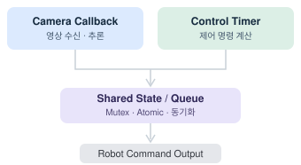

> [!PROMPT]
> 로보틱스 신입 sw개발 채용의 jd기준, 요구하는 c++ 및 python 개발 능력의 기준, 수준, 기술용어 및 활용사례의 요구 수준이 어느정도일지 궁금해.

> [!NOTE]
> ChatGPT 답변 공유 링크에서 가져온 원문입니다. 문장·표는 바꾸지 않았습니다. 3절 개념도는 공유 페이지에 들어 있던 SVG 원본을 파일로 옮겼고(어두운 배경에서 보이도록 선·화살표 색만 변경 — 상자와 글자 색은 원본 그대로), 2절 공고 카드(배지·채용공고 링크 포함), 5절 예상 질문 카드(원문은 눌러 펼치는 목록이라 모두 펼친 상태로), 7절 목표 수준 표시(원문의 막대를 등급 배지로)는 화면에 보이는 같은 글자를 레이아웃 태그로 다시 배치했습니다. 7절 단계 카드도 같은 글자를 상자로 다시 배치하고 원문 아이콘(code·activity·git-branch)을 붙였습니다. 2단계 카드의 아이콘(원문 이름 nodes)은 사이트 아이콘 목록(lucide)에 없어 뺐습니다. 답변 끝의 후속 질문 제안 목록은 뺐습니다.

# 로보틱스 신입 SW 개발자에게 요구되는 C++·Python 역량

로보틱스 신입 개발자 채용에서 C++과 Python을 요구한다는 것은 단순히 두 언어의 문법을 알고 코딩할 수 있는지를 의미하지 않습니다.

기업이 실제로 평가하려는 핵심은 **로봇의 센서·인지·판단·제어 기능을 소프트웨어로 구현하고, 실제 하드웨어 환경에서 발생하는 문제를 분석하고 해결할 수 있는가**입니다.

다만 로보틱스 SW 직무도 세부 분야에 따라 요구 수준이 상당히 다릅니다.

## 1\. 로보틱스 SW 직무별 언어 요구 수준

아래는 신입 채용을 해석하기 위한 일반적인 기준입니다. 실제 기업별 JD와 구분해야 합니다.

| 직무 | C++ | Python | 핵심 기술 |
|--------|--------|--------|--------|
| 로봇 제어 SW | 높음 | 중간 | 제어주기, 실시간성, 모션 제어 |
| ROS 2 SW 개발 | 높음 | 높음 | rclcpp, rclpy, DDS, 멀티스레딩 |
| 자율주행·AMR | 높음 | 중상 | SLAM, Navigation, 센서 융합 |
| 로봇 비전·AI | 중간 | 높음 | OpenCV, PyTorch, 추론 최적화 |
| 로봇 시뮬레이션 | 중간 | 높음 | Isaac Sim, Gazebo, 물리 엔진 |
| 임베디드·펌웨어 | 매우 높음 | 낮음\~중간 | 메모리, 통신, RTOS, MCU |
| 로봇 시스템 통합 | 중상 | 높음 | ROS 2, Linux, 통신, 디버깅 |

여기서 중요한 구분은 **언어 자체의 숙련도와 해당 언어로 로봇 시스템을 구현하는 역량이 다르다**는 점입니다.

예를 들어 Python으로 ROS 2 노드를 만들고, YOLO 추론 결과를 받아 로봇 동작을 결정하는 시스템을 구현했다면 Python을 활용한 로봇 응용 개발 경험으로 인정받을 수 있습니다.

그러나 같은 경험만으로 C++의 메모리 관리, 객체 수명, 동시성, 실시간 성능 최적화까지 이해한다고 평가받기는 어렵습니다.

## 2\. 실제 국내 로봇 기업 JD 분석

2026년 채용공고를 기준으로 보면, 신입 지원자에게 요구하는 역량은 기업과 직무에 따라 차이가 있습니다.

<box gap={2}>
  <box border radius="lg" padding={3} gap={1}>
    <row justify=between>
      <text weight="semibold">로보티즈 — 휴머노이드 시스템 SW</text>
      <badge>신입 지원 가능</badge>
    </row>
    <text>C++ 또는 Python 개발 경험, ROS 2, Linux 디버깅, 하드웨어 연동 이해를 요구합니다. `ros2_control`, DYNAMIXEL SDK 경험은 우대사항입니다.</text>
    <caption>해석: ROS 2 기반 실물 로봇 개발 경험을 증명하는 것이 중요합니다.</caption>
    <text size="sm"><Link url="https://www.jobkorea.co.kr/Recruit/GI_Read_Comt_Worknet_Ifrm?Gno=49475823&utm_source=chatgpt.com" title="채용공고 확인"/></text>
  </box>
  <box border radius="lg" padding={3} gap={1}>
    <row justify=between>
      <text weight="semibold">레인보우로보틱스 — 로봇 AI SW 개발</text>
      <badge>졸업예정자 지원 가능</badge>
    </row>
    <text>Python 또는 C++, Linux, Git, 로봇 SW·AI·시뮬레이션 중 하나 이상의 프로젝트 경험을 요구합니다. ROS 2, MoveIt 2, Isaac Sim 등이 우대사항입니다.</text>
    <caption>해석: 언어 숙련도뿐 아니라 프로젝트 구현·테스트·문제 해결 능력을 강조합니다.</caption>
    <text size="sm"><Link url="https://rainbow-robotics.com/%EC%B1%84%EC%9A%A9/%EC%B1%84%EC%9A%A9%EA%B3%B5%EA%B3%A0/?mod=document&uid=179&utm_source=chatgpt.com" title="채용공고 확인"/></text>
  </box>
  <box border radius="lg" padding={3} gap={1}>
    <row justify=between>
      <text weight="semibold">네이버랩스 — Robot System SW</text>
      <badge>신입·경력</badge>
    </row>
    <text>C/C++ 개발 경험, Linux 또는 MCU/SoC 환경 개발, 실시간 시스템, 통신 프로토콜 및 운영체제 기초를 요구합니다.</text>
    <caption>해석: ROS 패키지 활용을 넘어 시스템 프로그래밍과 하드웨어 인터페이스 이해가 중요합니다.</caption>
    <text size="sm"><Link url="https://m.jobkorea.co.kr/Recruit/GIReadDetailContentIframe/49951585?PageGbn=MST&sc=545&utm_source=chatgpt.com" title="채용공고 확인"/></text>
  </box>
  <box border radius="lg" padding={3} gap={1}>
    <row justify=between>
      <text weight="semibold">HD현대로보틱스 — 로봇 공통 SW</text>
      <badge>신입·경력</badge>
    </row>
    <text>2026년 상반기 모집요강에서 학사 이상, C/C++ 활용 능력을 요구했습니다. 교시, 모니터링, 통신, 플레이백 엔진 등 산업용 로봇 SW가 주요 업무입니다.</text>
    <caption>해석: 산업용 로봇 제어 및 제품 SW에서는 C/C++ 중심의 구현 역량이 특히 중요합니다.</caption>
    <text size="sm"><Link url="https://cse.snu.ac.kr/api/v1/file/1773721316758_%5BHD%ED%98%84%EB%8C%80%5D%2026%EB%85%84%20%EC%83%81%EB%B0%98%EA%B8%B0%20%EC%97%B0%EA%B5%AC%EA%B3%B5%EC%B1%84%20%EC%A7%81%EB%AC%BC%20%EB%A6%AC%ED%94%8C%EB%A0%9B_V4.pdf?utm_source=chatgpt.com" title="모집요강 PDF"/></text>
  </box>
</box>

이 공고들에서 공통적으로 발견되는 특징은 다음과 같습니다.

- **C++ 또는 Python**\: 일부 기업은 둘 중 하나의 개발 경험만 필수로 명시합니다.
- **Linux 및 ROS 2**\: 로봇 SW 직무에서 실질적인 개발 환경으로 자주 등장합니다.
- **실물 로봇 경험**\: 센서, 모터, 제어기 연동과 장애 분석 경험을 중시합니다.
- **시스템 SW 직무**\: 운영체제, 통신, 동시성, 실시간성까지 요구 수준이 올라갑니다.

특히 채용공고에 `신입·경력`이라고 표시되어 있더라도 상세 자격요건에는 2\~3년 이상의 경험을 요구하는 경우가 있으므로, 제목보다 필수 자격요건을 우선 확인해야 합니다.

---

## 3\. C++ 요구 수준 — 어느 정도까지 공부해야 할까?

신입 로봇 SW 개발자 기준으로 다음과 같이 4단계로 구분할 수 있습니다.

| 수준 | 구현 가능한 내용 | 채용 관점 |
|--------|--------|--------|
| L1. 기초 | 문법, 반복문, 함수, 배열, 클래스 | 기본 학습 단계 |
| L2. 응용 | STL, 포인터, 참조, 객체지향, 파일 분리 | 신입 최소 기반 |
| L3. 실무형 | 스마트 포인터, RAII, CMake, ROS 2 노드, 디버깅 | **일반적인 목표 수준** |
| L4. 심화 | 멀티스레딩, 동기화, 성능 분석, 실시간성, 메모리 최적화 | 시스템·제어 직무 경쟁력 |

이 단계는 공식적인 업계 등급이 아니라 실무 준비를 위해 구성한 평가 기준입니다.

### C++ 핵심 기술용어와 활용 사례

| 기술 | 알아야 하는 내용 | 로보틱스 활용 |
|--------|--------|--------|
| OOP | 클래스, 상속, 다형성, 캡슐화 | 센서·컨트롤러 추상화 |
| Pointer / Reference | 주소, 참조, 객체 수명 | 센서 데이터와 객체 전달 |
| Smart Pointer | `unique_ptr`, `shared_ptr` | ROS 2 노드와 리소스 관리 |
| STL | `vector`, `map`, `queue` | 경로점, 센서 버퍼, 탐색 알고리즘 |
| RAII | 객체 수명에 따른 자원 관리 | 장치 핸들, mutex, 파일 관리 |
| Multithreading | `std::thread`, mutex, atomic | 센서 수신과 제어 작업 분리 |
| CMake | 빌드, 라이브러리 링크 | ROS 2 C++ 패키지 개발 |
| Debugging | GDB, sanitizer | 충돌, 메모리 오류, 경쟁 상태 분석 |
| Move semantics | 이동 생성자, `std::move` | 대용량 데이터의 불필요한 복사 감소 |
| Real-time | 실행시간, 지터, deadline | 주기적인 제어 명령 처리 |

예를 들어 ROS 2에서 카메라 데이터 처리와 로봇 제어를 동시에 수행한다고 가정하겠습니다.

개념도: 병렬 콜백과 공유 데이터 동기화. 실제 ROS 2에서는 executor와 callback group 설정에 따라 병렬 실행 여부가 달라집니다.

신입에게 반드시 고급 lock-free 알고리즘까지 구현하라고 기대하지는 않지만, 시스템 SW 직무라면 다음 질문에 답할 수 있어야 경쟁력이 있습니다.

- 두 콜백이 같은 데이터를 수정하면 어떤 문제가 발생하는가?
- `mutex`와 `atomic`은 어떻게 다른가?
- `MultiThreadedExecutor`를 사용해도 콜백이 병렬 실행되지 않을 수 있는 이유는?
- 카메라 추론이 100ms 걸릴 때 10ms 제어주기를 어떻게 보호할 것인가?

특히 마지막 질문은 C++ 문법뿐 아니라 ROS 2 실행 구조와 로봇 제어의 실시간성까지 연결됩니다.

---

## 4\. Python 요구 수준 — 어느 정도까지 공부해야 할까?

Python은 로보틱스에서 알고리즘 개발, AI 추론, 센서 데이터 처리, 테스트 자동화, 상위 제어 로직 등에 널리 활용됩니다.

| 수준 | 구현 가능한 내용 | 채용 관점 |
|--------|--------|--------|
| L1. 기초 | 함수, 자료구조, 모듈, 예외 처리 | 기본 학습 |
| L2. 응용 | 클래스, NumPy, 파일 I/O, 외부 라이브러리 | 신입 최소 기반 |
| L3. 실무형 | ROS 2 노드, 데이터 파이프라인, 로깅, 테스트 | **일반적인 목표 수준** |
| L4. 심화 | 비동기 처리, 프로파일링, 병목 분석, 배포, AI 최적화 | AI·시스템 통합 직무 경쟁력 |

### Python 핵심 기술용어와 활용 사례

| 기술 | 알아야 하는 내용 | 로보틱스 활용 |
|--------|--------|--------|
| NumPy | 배열 연산, broadcasting | 좌표변환, 센서 데이터 |
| OpenCV | 영상 처리, 좌표계 | 카메라 인식 |
| OOP | 클래스, 상속, 모듈화 | FSM, ROS 2 노드 설계 |
| Exception handling | `try/except/finally` | 센서 오류·통신 예외 처리 |
| Threading | 스레드, GIL, 동기화 | I/O 작업 분리 |
| Multiprocessing | 프로세스, IPC | CPU 병렬 연산 |
| Asyncio | 이벤트 루프, 코루틴 | 비동기 네트워크 통신 |
| PyTorch | Tensor, GPU, 모델 추론 | YOLO, AI 인식 |
| Profiling | `cProfile`, 시간 측정 | FPS·레이턴시 병목 분석 |
| Testing | `pytest`, mocking | 알고리즘 및 인터페이스 검증 |
| Packaging | venv, pip, 의존성 관리 | 실행 환경 재현 |

Python의 경우 특히 **라이브러리를 사용할 수 있는 수준과 라이브러리 내부 동작을 이해하고 수정할 수 있는 수준**을 구분해야 합니다.

예를 들어 YOLO 모델을 불러와 추론하는 것과, Tensor의 shape, GPU 메모리, 전처리·후처리, 배치 처리, 추론 레이턴시를 분석하는 것은 요구되는 개발 역량이 다릅니다.

신입 로봇 AI 응용 개발자라면 전자를 직접 구현하고, 후자의 기본 원리를 설명하며 병목을 측정할 수 있는 수준을 우선 목표로 삼는 것이 합리적입니다.

## 5\. 실제 기술면접에서는 무엇을 확인할까?

다음은 앞서 확인한 JD를 바탕으로 구성한 예상 실무 질문입니다. 기업의 실제 기출문제는 아닙니다.

<box gap={2}>
  <box border radius="lg" padding={3} gap={1}>
    <text color="secondary" weight="medium" size="xs">01</text>
    <text weight="semibold">C++의 포인터와 참조는 어떻게 다르며, shared_ptr은 언제 사용하나요?</text>
    <caption>객체의 소유권과 수명을 설명하고, shared_ptr의 참조 카운팅 및 순환 참조 위험을 설명할 수 있어야 합니다.</caption>
  </box>
  <box border radius="lg" padding={3} gap={1}>
    <text color="secondary" weight="medium" size="xs">02</text>
    <text weight="semibold">ROS 2에서 센서 토픽 수신이 느려지거나 누락된다면 어떻게 진단하나요?</text>
    <caption>Publisher 주기, QoS, 네트워크, Executor, Callback 처리시간을 구분해 측정하고 ros2 topic hz, 로그, 프로파일링으로 원인을 좁힙니다.</caption>
  </box>
  <box border radius="lg" padding={3} gap={1}>
    <text color="secondary" weight="medium" size="xs">03</text>
    <text weight="semibold">Python에서 Threading과 Multiprocessing은 어떤 차이가 있나요?</text>
    <caption>프로세스별 메모리 공간, IPC 비용, CPython의 GIL, I/O bound와 CPU bound 작업의 차이를 설명해야 합니다.</caption>
  </box>
  <box border radius="lg" padding={3} gap={1}>
    <text color="secondary" weight="medium" size="xs">04</text>
    <text weight="semibold">카메라 해상도를 올렸더니 FPS가 떨어졌다면 어떻게 해결하나요?</text>
    <caption>USB 대역폭, 픽셀 포맷, 디코딩, 메모리 복사, 추론 시간, 시각화 단계별 소요시간을 측정해 병목을 확인합니다.</caption>
  </box>
  <box border radius="lg" padding={3} gap={1}>
    <text color="secondary" weight="medium" size="xs">05</text>
    <text weight="semibold">로봇이 실행 도중 안전정지한다면 어떤 순서로 디버깅하나요?</text>
    <caption>안전 알람과 상태 로그를 먼저 확보하고, trajectory, controller, 통신, 하드웨어 상태를 분리해 원인을 재현·검증합니다.</caption>
  </box>
</box>

이러한 질문에서 평가되는 것은 단순히 정답을 암기했는지가 아닙니다. **기술의 동작 원리 → 실제 문제 발생 → 원인 가설 → 검증 방법 → 개선 결과**를 논리적으로 설명할 수 있는지가 중요합니다.

## 6\. 현재 프로젝트 경험을 기준으로 한 역량 평가

지금까지 대화에서 다뤘던 프로젝트를 기준으로 보면, 로봇 응용 SW 개발에 필요한 경험은 상당 부분 확보한 것으로 보입니다. 다만 실제 코드 품질이나 독립 구현 능력까지 확인한 평가는 아닙니다.

| 역량 | 경험 근거 | 잠정 평가 |
|--------|--------|--------|
| Python 응용 | ROS 2 노드, FSM, YOLO, 데이터 처리 | L2\~L3 |
| ROS 2 | 센서 통합, 토픽, 서비스, MoveIt 2 | L3 후보 |
| Linux 개발 | Ubuntu, 빌드 오류, 환경 문제 해결 | L2\~L3 |
| 로봇 알고리즘 | EKF, Stanley, Pure Pursuit, 경로 추종 | 응용 경험 강점 |
| AI·Simulation | Isaac Sim, YOLO, GraspGenX | 응용 경험 강점 |
| C++ | 직접 구현한 코드에 대한 정보 부족 | 평가 보류 |
| 시스템 SW | 동시성, 메모리, 디버거, 성능 최적화 | 추가 검증 필요 |

특히 M0609을 활용한 MoveIt 2 제어, Isaac Sim 환경 구축, ERP42의 경로추종 및 센서 융합 경험은 로봇 SW 지원서에서 구체적으로 설명하기 좋은 사례입니다.

다만 **ROS 2를 활용한 경험이 많다고 C++ 시스템 프로그래밍까지 숙련되었다는 의미는 아닙니다.** 이 부분은 별도로 준비하는 것이 좋습니다.

## 7\. 앞으로 우선적으로 강화할 역량

제 판단으로는 새로운 로봇 프레임워크를 계속 학습하기보다, 기존 프로젝트 하나를 **C++ 기반의 유지보수 가능한 소프트웨어로 재구현하고 검증하는 것**이 채용 준비에 더 효과적입니다.

<box gap={2}>
  <box border radius="lg" padding={3} gap={1}>
    <row gap={2} align=center>
      <icon name="code"/>
      <text weight="semibold">1단계 — C++17 기본기</text>
    </row>
    <text>STL, 클래스, 포인터, 스마트 포인터, RAII, const correctness, CMake를 학습합니다. 기존 Python 경로추종 알고리즘을 C++로 재구현해 볼 수 있습니다.</text>
  </box>
  <box border radius="lg" padding={3} gap={1}>
    <row gap={2} align=center>
      <text weight="semibold">2단계 — ROS 2 C++ 패키지</text>
    </row>
    <text>`rclcpp` 기반 Publisher, Subscriber, Timer, Service, Action을 구현하고 Executor, QoS, Callback Group을 이해합니다.</text>
  </box>
  <box border radius="lg" padding={3} gap={1}>
    <row gap={2} align=center>
      <icon name="activity"/>
      <text weight="semibold">3단계 — 성능 측정과 디버깅</text>
    </row>
    <text>`gdb`, AddressSanitizer, `perf`, ROS 2 tracing 등을 활용해 메모리 오류, CPU 사용률, 처리시간, 지터를 측정합니다.</text>
  </box>
  <box border radius="lg" padding={3} gap={1}>
    <row gap={2} align=center>
      <icon name="git-branch"/>
      <text weight="semibold">4단계 — 소프트웨어 품질과 협업</text>
    </row>
    <text>`Git`, `pytest`, `GoogleTest`, CI, 코드 리뷰, README, 재현 가능한 실행 환경을 구축합니다.</text>
  </box>
</box>

### 목표 수준 정리

<box border radius="xl" padding={3} gap={2}>
  <text weight="semibold">추천 목표 — ROS 2 기반 로봇 응용 SW 신입</text>
  <row justify=between>
    <text>C++</text>
    <badge>L3</badge>
  </row>
  <row justify=between>
    <text>Python</text>
    <badge>L3</badge>
  </row>
  <row justify=between>
    <text>ROS 2</text>
    <badge>L3</badge>
  </row>
  <row justify=between>
    <text>Linux / Debugging</text>
    <badge>L3</badge>
  </row>
  <row justify=between>
    <text>실시간·시스템 SW</text>
    <badge>L2</badge>
  </row>
  <caption>L1 기초 · L2 응용 · L3 실무형 · L4 심화. 공식 채용 기준이 아닌 권장 학습 목표입니다.</caption>
</box>

**결론적으로**, 로봇 응용 SW 신입이라면 C++과 Python 모두 L3 수준을 목표로 하되, 두 언어를 똑같이 깊게 공부할 필요는 없습니다. ROS 2·시스템·제어 개발을 지향한다면 C++에 더 투자하고, 로봇 AI·인지·시뮬레이션 개발을 지향한다면 Python을 중심으로 C++ 연동 능력을 확보하는 것이 좋겠습니다.

한 가지 확인하고 싶은 것은 **목표 직무가 로봇 제어·시스템 SW(C++ 중심)인지, 로봇 AI·비전·시뮬레이션 SW(Python 중심)인지**입니다. 이에 따라 신입 코딩테스트 준비 범위부터 포트폴리오 수준까지 상당히 달라집니다.

---

확신도: 검증됨(같은 턴 도구 출력으로 확인) — JD 요구사항 / 추론 — 역량 수준 평가 및 학습 권고

내가 채워넣은 가정: 국내 학사 신입 채용 기준, ROS 2 기반 로봇 응용 SW 직무 우선, L1\~L4는 자체 평가 척도

확인 요청: 목표 직무는 ① 로봇 제어·시스템 SW ② 로봇 AI·비전·시뮬레이션 SW 중 어느 쪽인가요?
