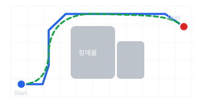
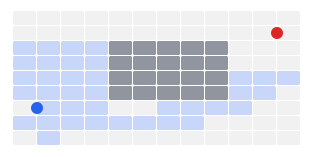
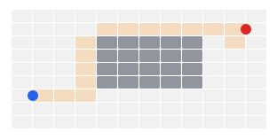
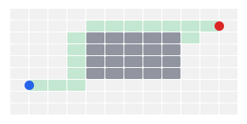
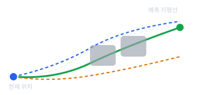

> [!PROMPT]
> 로보틱스 경로생성 알고리즘 질문. 다익스트라, greedy, a* 등 각 특징과 방식 설명. 또한 그 외에도 다양하게 활용되는, 주목받는 알고리즘 설명해줘

> [!NOTE]
> 답변 원문에 있던 설명·표·수식과 학습 순서를 유지한 게시본입니다. ChatGPT 전용 동적 격자 그림, SVG, 이미지 검색 위젯은 같은 파일로 옮길 수 없어 일부 시각자료를 Mermaid 흐름도와 텍스트로 재구성했습니다. 원문 시각자료와 동일한 그림이라는 의미는 아닙니다. 원문의 일회성 출처 토큰은 제거하고 공식 문서 링크를 맨 아래에 별도로 기재했습니다.
>
> **2026-11-16 보완:** 답변 공유본과 대조해 게시 때 빠진 문장 2개, Nav2 구성도의 단계 설명, "(우선)" 표기, 인라인 코드 표기 6곳, MPC 개념도 SVG, 답변 끝의 확신도·가정 줄을 되살렸습니다. SVG는 어두운 배경에서 보이도록 글자·보조선 색만 바꿨고, 범례의 선 모양 설명은 그림을 보고 덧붙인 것입니다. 격자 탐색 비교 그림 3개와 경로 비교 그림은 답변 공유 페이지에 들어 있던 SVG를 가져와 넣었습니다(경로 비교 그림은 어두운 배경용으로 기본 글자색만 변경, 격자 그림은 원래 색이 보이도록 흰 바탕만 추가, 격자 아래 설명 3개는 공유 화면의 문구). RRT 그림과 로봇 사진은 외부 이미지라 재사용 권한을 확인할 수 없어 넣지 않았습니다.

# 로보틱스 경로 탐색·경로 계획 알고리즘 총정리

로봇이 출발점에서 목표점까지 이동하는 경로를 생성하는 기술은 단순히 **최단 거리를 찾는 문제**에서 출발해, 현재는 **로봇의 운동학적 제약, 동적 장애물, 연산 시간, 안전성까지 고려하는 Motion Planning**으로 발전했습니다.

대표적인 Dijkstra, Greedy Best-First Search, A*는 모두 그래프 탐색(Graph Search) 계열이지만, 실제 로보틱스에서는 Hybrid A*, D* Lite, RRT*, MPC 등 여러 알고리즘을 목적에 따라 조합합니다.

## 1. 먼저 구분할 개념: Path Planning과 Trajectory Planning

| 개념 | 핵심 질문 | 출력 |
|---|---|---|
| Pathfinding | 어떤 길로 가야 하는가? | 노드·격자 경로 |
| Path Planning | 로봇이 실제로 이동 가능한 길인가? | 기하학적·운동학적 경로 |
| Trajectory Planning | 언제, 얼마나 빠르게 이동할 것인가? | 시간별 위치·속도·가속도 |
| Motion Control | 계산된 움직임을 어떻게 실행할 것인가? | 조향·속도·토크 명령 |

예를 들어 자동차형 로봇은 A*가 계산한 최단 경로에 직각 모서리가 존재하면 그대로 주행할 수 없습니다. 최소 회전반경이 있기 때문입니다.

따라서 **최단 경로와 실제 주행 가능한 경로는 서로 다를 수 있습니다.**

범례: 경로 탐색 결과(파랑) · 곡선형 경로 예시(초록)

개념도: 장애물을 피하는 경로와 더 부드러운 주행 경로의 차이. 녹색 경로도 충돌·곡률 검증이 별도로 필요합니다.

> [!WARNING]
> **재구성 시각자료:** 원문에는 장애물을 피해 가는 꺾인 경로와 곡선형 경로를 비교하는 SVG가 있습니다. 아래는 게시용 흐름도이며 원본 그림과 동일하지 않습니다.

~~~mermaid
flowchart LR
 A["출발점"] --> B["격자/그래프 탐색"]
 B --> C["충돌 없는 경로"]
 C --> D["곡률·운동학 검증"]
 D --> E["속도·시간 할당"]
 E --> F["제어 명령 실행"]
~~~

---

## 2. 기본 그래프 탐색 알고리즘 3종

세 알고리즘의 차이는 다음 평가함수로 가장 명확하게 이해할 수 있습니다.

$$
\boxed{f(n)=g(n)+h(n)}
$$

- $g(n)$: 출발점에서 현재 노드 $n$까지 누적 이동 비용
- $h(n)$: 현재 노드에서 목적지까지 예상되는 잔여 비용(휴리스틱)
- $f(n)$: 어떤 노드를 우선 탐색할지 결정하는 평가값

### 동일 지도에서의 탐색 방식 비교

| Dijkstra | Greedy Best-First | A* |
|---|---|---|
|  |  |  |
| 목표 외 방향까지 확장 | 목표 쪽을 우선 탐색 | 실제 비용과 추정 비용을 함께 고려 |

위 격자들은 탐색 성향을 설명하기 위한 개념도이며, 동일 조건에서 실제 알고리즘을 실행해 얻은 탐색 노드 수나 경로 결과는 아닙니다.

### ① Dijkstra — 비용이 낮은 곳부터 확장

$$
f(n)=g(n)
$$

**동작 방식**

1. 시작 노드의 누적 비용을 0으로 초기화합니다.
2. 지금까지 발견한 노드 중 누적 비용이 가장 작은 노드를 선택합니다.
3. 이웃 노드로 이동할 때의 비용을 계산하고 갱신합니다.
4. 목표에 도착할 때까지 반복합니다.

특징은 목표의 방향을 고려하지 않는다는 점입니다. 마치 물결이 사방으로 확산되듯 탐색합니다.

**장점:** 비음수 간선 비용을 갖는 그래프에서 최단 경로 보장, 구현이 비교적 단순, 여러 목적지까지의 최단 경로 계산에 유용.

**단점:** 목표 방향을 활용하지 않기 때문에 넓은 공간에서는 불필요한 탐색이 많아질 수 있습니다.

활용: AMR의 기본 경로 탐색, 도로망 최단 경로, 거리 맵 계산.

### ② Greedy Best-First Search — 목표에 가까워 보이는 곳부터 탐색

$$
f(n)=h(n)
$$

누적 이동 거리는 무시하고 목적지까지 예상되는 거리가 가장 작은 노드부터 확장합니다.

예를 들어 목적지가 오른쪽에 있다면 오른쪽 방향을 계속 선호합니다. 하지만 중간에 긴 벽이 있으면 실제로는 왼쪽으로 크게 우회해야 하는 상황에서도 벽 근처를 먼저 탐색할 수 있습니다.

**장점:** 휴리스틱이 잘 맞는 환경에서 빠르게 해를 발견할 가능성이 있습니다.

**단점:** 최단 경로 보장이 없고 장애물 배치에 따라 비효율적인 경로를 찾을 수 있습니다. 탐색 자체도 항상 빠르다고 보장할 수는 없습니다.

활용: 빠른 경로 후보 탐색, 휴리스틱 기반 탐색 원리 학습, 일부 실시간 탐색 시스템의 초기 해 탐색.

### ③ A* — 실제 이동 비용과 예상 비용을 함께 고려

$$
f(n)=g(n)+h(n)
$$

A*는 Dijkstra와 Greedy의 평가 요소를 결합합니다.

- 지금까지 얼마나 이동했는가?
- 앞으로 얼마나 이동해야 하는가?

이 두 정보를 동시에 고려해 우선순위 큐에서 가장 작은 $f(n)$ 값을 가진 노드를 확장합니다.

예를 들어,

| 후보 노드 | g(n) | h(n) | f(n) |
|---|---:|---:|---:|
| A | 5 | 12 | 17 |
| B | 9 | 4 | **13** |
| C | 3 | 15 | 18 |

A*는 B를 먼저 탐색합니다.

단, A*가 최적 경로를 보장하려면 휴리스틱이 실제 잔여 최적 비용을 과대평가하지 않는 등의 조건이 필요합니다. 일반적인 그래프 탐색에서는 일관성 있는 휴리스틱과 적절한 재확장 처리도 중요합니다.

대표적인 휴리스틱은 다음과 같습니다.

- Manhattan Distance: 상하좌우 4방향 격자에서 활용
- Euclidean Distance: 직선거리 기반
- Octile Distance: 직선·대각선 8방향 격자에서 활용

**장점:** 적절한 휴리스틱을 쓰면 Dijkstra보다 탐색량을 크게 줄일 수 있고 최적성을 보장할 수 있습니다.

**단점:** 탐색 공간이 커질수록 메모리 사용량이 증가하며, 일반적인 2D A*는 회전반경과 차량 자세까지 직접 고려하지 않습니다.

### 세 알고리즘 핵심 비교

| 항목 | Dijkstra | Greedy | A* |
|---|---|---|---|
| 우선순위 | g | h | g+h |
| 목표 방향 활용 | X | O | O |
| 최단 경로 보장 | O* | X | 조건부 O |
| 탐색 범위 | 대체로 넓음 | 상황에 따라 작음 | 휴리스틱에 따라 감소 |
| 대표 활용 | 최단 비용 지도 | 빠른 후보 탐색 | 전역 경로 탐색 |

* Dijkstra는 비음수 간선 비용, A*는 적절한 휴리스틱 및 구현 조건을 전제합니다. 탐색 속도와 범위는 지도 구조에 따라 달라집니다.

---

## 3. 실제 로보틱스에서 중요한 확장 탐색 알고리즘

A*만으로 모든 로봇의 경로를 생성할 수는 없습니다. 특히 장애물이 바뀌는 환경이나 조향 제약이 있는 로봇에서는 확장 알고리즘이 중요합니다.

### Hybrid A* — 차량의 움직임을 고려하는 A*

기존 A*의 $(x,y)$에 로봇의 방향 $\theta$를 추가해 $(x,y,\theta)$ 공간에서 탐색합니다. 전진·후진, 최소 회전반경 등을 고려해 조향 가능한 경로를 생성합니다.

자율주행차, Ackermann 차량, 주차 경로 계획에 특히 유용합니다.

### D* Lite — 바뀐 지도에 빠르게 적응하는 탐색

A*처럼 매번 처음부터 탐색하는 대신, 기존 탐색 정보와 비용 변화를 활용해 경로를 갱신합니다.

탐색 중 새로운 장애물을 발견하는 AMR, 탐사 로봇에서 유리합니다. D* Lite는 단순히 빠른 A*가 아니라 **증분 탐색(Incremental Search)** 알고리즘입니다.

### Theta* — 격자 방향 제약을 줄인 탐색

일반 A*가 격자의 연결 방향에 따라 이동하는 데 비해, Theta*는 두 지점 사이의 직선 가시성(Line of Sight)을 확인해 경로를 단축합니다.

45도 단위의 불필요한 꺾임을 줄일 수 있어 2D AMR 경로 계획에 적합합니다.

### 그 밖의 중요한 A* 계열

| 알고리즘 | 핵심 아이디어 | 대표 용도 |
|---|---|---|
| Weighted A* | $f=g+wh$, $w>1$ | 최적성 일부를 양보하고 탐색 가속 |
| ARA* | 빠른 초기 해를 찾고 점진적으로 개선 | 제한된 계산 시간 |
| LPA* | 이전 탐색 결과를 재사용 | 그래프 비용 변경 |
| D* Lite | 변경된 비용을 이용한 재계획 | 미지 환경 탐사 |
| Jump Point Search | 균일 격자에서 불필요한 노드 확장 생략 | 대규모 2D 격자 |
| Hybrid A* | 위치와 방향, 운동학 반영 | 자동차형 로봇 |
| State Lattice | 미리 정의된 실행 가능한 움직임을 연결 | 차량·비원형 AMR |

여기에서 주의할 점이 있습니다.

**Hybrid A*와 D* Lite는 서로 다른 문제를 해결합니다.**

Hybrid A*는 경로의 *주행 가능성*을, D* Lite는 환경이 바뀌었을 때의 *재탐색 효율*을 주로 개선합니다. 따라서 둘 중 어느 알고리즘이 더 우수한지 일괄적으로 비교할 수는 없습니다.

실제 ROS 2 Nav2에서도 Smac Hybrid-A*, Smac State Lattice, Theta* 등이 서로 다른 운동학적 특성에 맞게 제공됩니다.

---

## 4. 샘플링 기반 경로 계획: RRT, RRT*, PRM

격자 기반 탐색은 2차원 지도를 표현하는 데 유용하지만, 로봇팔과 같이 자유도(DOF)가 높은 시스템에서는 상태 공간이 급격히 증가합니다.

6축 로봇팔의 각 관절을 100단계로 이산화한다면 상태 조합만 $100^6=10^{12}$개입니다.

이러한 문제에 대응하기 위해 샘플링 기반 경로 계획이 널리 활용됩니다.

> [!WARNING]
> **원문 시각자료 대체 설명:** 원문에는 RRT, RRT*, PRM의 나무/경로망을 보여주는 외부 이미지 검색 위젯이 있었습니다. 실제 이미지 파일이 제공되지 않아 게시본에는 이미지를 재게시하지 않습니다.

RRT 계열은 샘플을 뽑아 탐색 트리를 확장하며, PRM은 충돌 없는 샘플들을 연결해 경로망을 구축합니다.

### ① RRT (Rapidly-exploring Random Tree)

공간에 무작위 점을 생성하고, 기존 트리에서 그 점과 가까운 노드를 선택해 가지를 뻗어나가는 방식입니다.

1. 임의의 샘플 $q_{rand}$ 생성
2. 트리에서 가장 가까운 노드 $q_{near}$ 탐색
3. 일정 거리만큼 $q_{new}$ 방향으로 확장
4. 충돌이 없으면 트리에 추가
5. 목표에 연결될 때까지 반복

장점은 고차원 공간을 직접 격자화하지 않고 탐색할 수 있다는 점입니다. 단점은 경로가 구불구불할 수 있고 최적 경로를 보장하지 않는다는 것입니다.

### ② RRT* — RRT의 경로 최적화 버전

RRT*는 새로운 노드가 만들어질 때 주변 노드와의 연결을 비교하고 비용이 더 낮아지도록 트리를 재연결(Rewiring)합니다.

샘플 수가 증가하면 적절한 가정하에서 최적 경로로 점근적으로 수렴합니다.

다만 초기 경로 발견과 최적 경로 수렴은 별개이므로 제한된 시간에서는 좋은 경로를 찾지 못할 수도 있습니다.

### ③ RRT-Connect — 양방향 탐색

출발점과 목표점에서 각각 트리를 확장하고 두 트리의 연결을 시도합니다.

실무적으로는 빠르게 실행 가능한 경로를 찾을 때 유용해 로봇팔의 MoveIt/OMPL 환경에서 자주 사용됩니다.

### ④ PRM (Probabilistic Roadmap)

장애물이 없는 공간에 샘플을 배치해 여러 노드를 연결한 **Roadmap(경로망)**을 생성합니다.

여러 출발점·목적지 쌍을 반복적으로 질의하는 환경에 적합합니다. 예컨대 고정된 산업용 로봇 셀에서 여러 작업 위치 사이의 경로를 반복 계획할 때 고려할 수 있습니다.

### ⑤ 최근까지 발전해 온 샘플링 알고리즘

| 알고리즘 | 개선 방향 |
|---|---|
| Informed RRT* | 첫 해를 찾은 뒤 유망한 공간에 샘플링 집중 |
| BIT* | 샘플링과 휴리스틱 기반 탐색 결합 |
| RRTX | 변경된 환경에서 탐색 트리 갱신 |
| FMT* | 샘플을 이용해 최적 경로 탐색 효율 개선 |

이들은 단순히 RRT보다 새로운 알고리즘이라는 이유로 우수한 것이 아니라, 최적화·탐색 수렴·재계획 같은 서로 다른 목표를 개선한 알고리즘입니다.

---

## 5. 최적화·제어 기반: MPC, MPPI, CHOMP

지금까지의 알고리즘은 주로 *어디로 이동할 것인지*에 초점을 맞췄습니다.

반면 실제 로봇은 장애물 회피뿐 아니라 속도, 가속도, 조향각, 가속도 변화율(Jerk)까지 고려해야 합니다.

### ① MPC (Model Predictive Control)

범례: 선택된 후보(굵은 초록 실선) · 다른 후보(파랑·주황 점선)

MPC/샘플링 제어의 개념도. 실제 MPC의 후보 생성 방식은 최적화 방법에 따라 달라집니다.

MPC는 미래의 일정 시간 구간에서 로봇의 상태 변화를 예측하고, 비용함수를 최소화하는 제어 입력을 계산합니다.

$$
J=\sum_{k=0}^{N-1}
\left(
w_e e_k^2+
w_u\|u_k\|^2+
w_o C_{\mathrm{obs},k}
\right)+J_{\mathrm{terminal}}
$$

여기서

- $e_k$: 목표 경로와의 오차
- $u_k$: 제어 입력
- $C_{\mathrm{obs},k}$: 장애물 관련 비용
- $N$: 예측 단계 수

매 제어 주기마다 최적화하지만, 계산된 명령 전체를 실행하지 않고 보통 첫 제어 입력만 실행한 뒤 다시 최적화합니다.

이것을 **Receding Horizon Control**이라고 합니다.

> [!WARNING]
> **재구성 시각자료:** 원문에는 MPC/샘플링 제어의 후보 경로 중 하나를 선택하는 SVG 개념도가 있었습니다. 아래는 게시용 설명 흐름도로, 원래의 궤적 곡선 그림과 동일하지 않습니다.

~~~mermaid
flowchart TD
 A["로봇 현재 상태"] --> B["미래 상태·후보 제어 입력 예측"]
 B --> C["경로 오차·충돌 비용·제어 비용 평가"]
 C --> D["최적 제어 입력 계산"]
 D --> E["첫 제어 입력만 실행"]
 E --> F["상태 재측정"]
 F --> B
~~~

### ② MPPI (Model Predictive Path Integral)

MPC 계열의 샘플링 기반 최적제어 기법입니다.

많은 제어 입력 시퀀스를 샘플링하고, 각 입력으로 예상되는 움직임을 계산해 비용에 따라 제어 입력을 갱신합니다.

복잡한 비선형 시스템 및 장애물 회피에 활용할 수 있으며 ROS 2 Nav2에도 MPPI Controller가 제공됩니다.

### ③ CHOMP (Covariant Hamiltonian Optimization for Motion Planning)

로봇팔의 초기 경로를 개선하는 궤적 최적화 알고리즘입니다.

장애물 충돌 비용과 경로의 부드러움 등을 함께 최적화합니다.

예를 들어 OMPL로 초기 충돌 회피 경로를 생성한 뒤 CHOMP로 더 부드러운 경로를 얻는 구성을 고려할 수 있습니다.

단, 국소 최적해(Local Minimum)에 빠질 수 있으므로 초기 경로의 품질이 중요합니다.

### 함께 알아둘 기법

- **DWA (Dynamic Window Approach):** 현재 속도와 가속도 제한 안에서 실행 가능한 속도 명령을 평가하는 국소 장애물 회피 기법.
- **TEB (Timed Elastic Band):** 시간 간격을 포함한 경로를 최적화해 장애물 거리 및 운동학적 제약을 반영하는 국소 계획 기법.
- **STOMP:** 확률적 궤적 섭동과 비용 평가를 이용하는 최적화 기반 Motion Planner.
- **Artificial Potential Field:** 목표점은 인력, 장애물은 척력으로 모델링하는 반응형 계획 방식. 단순하지만 국소 최소점 문제가 있습니다.

특히 **MPC·MPPI·DWA는 A*를 반드시 대체해야 하는 알고리즘이 아닙니다.** 전역 경로를 A*로 계획한 후 국소 제어에서 MPC나 MPPI를 적용하는 구성이 가능합니다.

---

## 6. 2025~2026년 주목할 발전 방향

최근 경로 계획 연구는 개별 알고리즘의 성능 개선뿐 아니라, 기존 탐색 기법과 최적제어·학습 기반 기법을 결합하는 방향으로 확장되고 있습니다.

2025년 IEEE Access 종합 리뷰와 2026년 동적 환경 Motion Planning 리뷰에서도 예측 기반 계획, 학습 기반 방법, 하이브리드 접근법이 주요 연구 축으로 다뤄집니다.

| 연구 방향 | 핵심 기술 | 기대 효과와 한계 |
|---|---|---|
| Learning-based Planning | 강화학습(RL), 모방학습 | 경험을 활용해 복잡한 상황 대응. 일반화·안전성 검증 필요 |
| Diffusion-based Planning | Diffusion Model | 다양한 궤적 후보 생성. 추론 비용·제약 만족이 과제 |
| Kinodynamic Planning | Kinodynamic RRT, MPC | 동역학·가속도까지 고려 |
| Multi-Agent Path Finding | CBS, Prioritized Planning | 여러 AMR의 충돌 없는 경로 조정 |
| Trajectory Optimization | CHOMP, STOMP, TrajOpt | 부드러움·충돌 거리·동작 비용 최적화 |
| Hybrid Planning | A* + MPC, RRT + 최적화 | 전역 탐색과 국소 제어의 장점 결합 |

여기서 Learning-based Planning과 Diffusion-based Planning은 활발한 연구 분야이지만, 기존 A*나 RRT 계열을 산업 전반에서 대체했다고 보기는 어렵습니다.

특히 산업용 로봇에서는 **충돌 검증 가능성, 재현성, 계산 지연의 예측 가능성**이 매우 중요하므로 검증된 탐색 알고리즘과 최적화 기법을 결합하는 접근이 실용적입니다.

---

## 7. ROS 2에서 알고리즘이 실제로 적용되는 위치

> [!WARNING]
> **재구성 시각자료:** 원문에서 박스와 화살표로 묘사한 Nav2 데이터 흐름을 Mermaid로 다시 구성했습니다.

~~~mermaid
flowchart TD
 A["SLAM / Localization / Costmap"] --> B["Global Planner"]
 B --> C["Local Controller / Trajectory Optimization"]
 C --> D["Robot Hardware"]
 B -. "Dijkstra · A* · Theta* · Hybrid A* · Lattice" .-> B
 C -. "MPPI · DWB · MPC · Pure Pursuit" .-> C
~~~

**SLAM / Localization / Costmap**

현재 위치와 장애물 지도 생성

**Global Planner**

Dijkstra · A* · Theta* · Hybrid A* · Lattice

출발점에서 목적지까지의 전역 경로

**Local Controller / Trajectory Optimization**

MPPI · DWB · MPC · Pure Pursuit

실시간 장애물·로봇 상태를 반영한 제어

**Robot Hardware**

속도·조향·관절 명령 실행

ROS 2 Nav2를 단순화한 구성도. 실제로는 BT Navigator, Planner Server, Controller Server, Costmap, Collision Monitor 등이 함께 동작합니다.

Nav2의 실제 플러그인 분류를 보면 다음과 같습니다.

| ROS 2 패키지/플러그인 | 구현 방식 | 적합한 로봇 |
|---|---|---|
| NavFn | Dijkstra / A* | 기본 2D 모바일 로봇 |
| Smac 2D | Cost-aware A* | 원형·전방향 AMR |
| ThetaStar | Any-angle Search | 2D 지도 기반 로봇 |
| Smac Hybrid | Hybrid A* | Ackermann 차량 |
| Smac Lattice | State Lattice | 다양한 운동학·형상을 가진 로봇 |
| MPPI Controller | 샘플링 기반 최적제어 | 동적 장애물 회피·경로 추종 |

로봇팔은 별도의 접근이 필요합니다. MoveIt 2는 OMPL을 통해 RRT-Connect, RRT* 등 다양한 고차원 샘플링 기반 계획 알고리즘을 지원합니다.

## 8. 로봇 유형별 알고리즘 선택

> [!NOTE]
> 원문에서는 각 로봇 설명에 외부 이미지 검색 위젯이 함께 배치됐으나, 게시 가능한 이미지 파일과 재사용 권한을 확인할 수 없어 이미지를 제외했습니다.

### TurtleBot4 · 실내 AMR

추천 시작점: `Smac 2D` 또는 `NavFn` + `Regulated Pure Pursuit`

격자 기반 경로 탐색을 이해하기 좋고, Nav2 플러그인별 탐색 결과와 추종 성능을 비교하기 쉽습니다. 장애물이 많은 환경에서는 MPPI도 비교해 볼 만합니다.

### ERP42 · Ackermann 자율주행 차량

추천 시작점: `Hybrid A*` + `Pure Pursuit / Stanley`

기존 waypoint 추종 구조에 장애물 회피 기능을 확장한다면 Hybrid A*가 유용합니다. 더 높은 수준의 동역학 제어가 필요해지면 MPC를 검토할 수 있습니다.

### Doosan M0609 · 협동로봇

추천 시작점: `RRT-Connect` + MoveIt 2

6축 관절 공간에서 충돌 없는 경로를 찾고, 이후 시간 파라미터화·궤적 검증을 수행합니다. CHOMP나 RRT*는 경로 품질 비교용으로 확장하기 좋습니다.

## 9. 학습 우선순위와 실습 제안

현재 ROS 2와 모바일 로봇, 협동로봇을 함께 다루는 관점이라면 모든 알고리즘을 개별적으로 구현할 필요는 없습니다.

### 1단계 — 그래프 탐색 원리 이해 (우선)

Python으로 Dijkstra, Greedy, A*를 같은 Occupancy Grid에서 구현하고 탐색 노드 수, 경로 길이, 계산 시간을 비교합니다.

### 2단계 — 실제 주행 가능 경로 생성

A*와 Hybrid A*를 비교하며 차량 자세와 최소 회전반경이 경로 생성에 어떻게 영향을 미치는지 실험합니다.

### 3단계 — ROS 2 Nav2 통합

NavFn, Smac 2D, Hybrid A*의 결과를 RViz에서 비교하고 Costmap과 Footprint가 경로에 미치는 영향을 분석합니다.

### 4단계 — 동적 환경과 경로 최적화

D* Lite의 재계획 특성을 학습하고 MPPI/MPC를 이용한 실시간 제어 개념으로 확장합니다.

### 5단계 — 로봇팔 Motion Planning

MoveIt 2에서 RRT-Connect, RRT*, CHOMP를 비교해 계획 시간, 충돌 검증, 관절 경로 길이, 궤적 부드러움을 평가합니다.

### 직접 비교할 핵심 성능 지표

| 지표 | 의미 |
|---|---|
| Planning Time | 경로 계산에 필요한 시간 |
| Path Length | 생성 경로의 총 길이 |
| Success Rate | 제한 시간 내 유효 경로 생성 비율 |
| Minimum Clearance | 장애물과의 최소 거리 |
| Curvature | 경로의 곡률 및 조향 가능성 |
| Replanning Latency | 환경 변화 후 경로 갱신 지연 |
| Trajectory Smoothness | 가속도·Jerk 등 궤적의 연속성 |

**핵심 결론:** 경로 계획 분야에서 중요한 것은 가장 최신 알고리즘 하나를 선택하는 것이 아니라, 로봇의 운동학적 특성과 환경 변화, 연산 자원에 맞게 탐색·최적화·제어 알고리즘을 구성하는 것입니다.

기초는 **Dijkstra → A* → Hybrid A*** 순서로 학습하고, 이후 모바일 로봇은 D* Lite와 MPC/MPPI, 로봇팔은 RRT-Connect와 궤적 최적화로 확장하는 학습 경로를 추천합니다.

### 참고 공식 문서

- [Nav2 Navigation Plugins](https://docs.nav2.org/rolling/configuration_and_development/navigation_plugins/)
- [OMPL Available Planners](https://ompl.kavrakilab.org/planners.html)

---

확신도: 검증됨(같은 턴 도구 출력으로 확인) — Nav2·OMPL의 지원 알고리즘과 기본 특성. 추론(근거 있으나 미확인) — 사용자 프로젝트별 알고리즘 추천 및 학습 우선순위.

내가 채워넣은 가정: ① 전역 경로 탐색과 국소 궤적 계획을 모두 포함 ② ROS 2 모바일 로봇과 협동로봇을 주요 적용 대상으로 설정

확인 요청: 없음

---

> [!NOTE]
> **원문 출처 및 검증 한계:** 이 글의 주요 설명은 사용자가 요청한 동일 대화 내 답변에서 옮겼습니다. ChatGPT 화면의 일회성 검색 결과 식별자(\`turn…\`)는 외부 웹사이트에서 열 수 있는 출처 URL이 아니므로 옮기지 않았습니다. 원문에서 언급한 2025년·2026년 리뷰 논문의 서지정보는 별도 확인하지 못했습니다.
